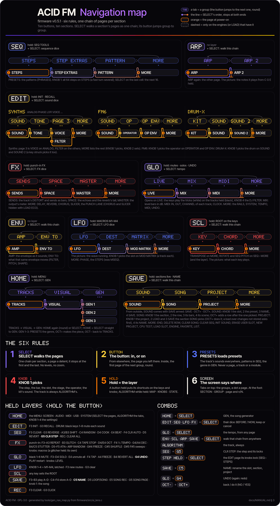

# Braindancer — User Manual

*(Braindancer, formerly ACID FM: the name up to 0.6.)*

**For the M-VAVE FM-1** · the interactive manual: <https://norfolkhacker.github.io/braindancer/manual/>

This manual is for musicians who have just installed Braindancer and want to know how to play it, build songs with it
and, above all, **save their work without losing anything**. Every button, knob and message is named exactly as the
device shows it.

If you only read one chapter, read [12. Saving and loading](#12-saving-and-loading).

## Contents

0. [Quick start](#0-quick-start)
1. [The panel](#1-the-panel)
2. [The screen](#2-the-screen)
3. [Pages and layers](#3-pages-and-layers)
4. [Engines](#4-engines)
5. [DRUM-X](#5-drum-x)
6. [The sequencer](#6-the-sequencer)
7. [SONG: songs, sections and scenes](#7-song-songs-sections-and-scenes)
8. [Dice and UNDO](#8-dice-and-undo)
9. [Effects and master](#9-effects-and-master)
10. [Modulation and macros](#10-modulation-and-macros)
11. [Performance](#11-performance)
12. [Saving and loading](#12-saving-and-loading)
13. [System: TRACKS, LOAD and the MENU](#13-system-tracks-load-and-the-menu)
14. [MIDI and USB](#14-midi-and-usb)
15. [Web tools: emulator, installer, editor, backup](#15-web-tools-emulator-installer-editor-backup)
16. [Troubleshooting and FAQ](#16-troubleshooting-and-faq)
17. [Credits and licence](#17-credits-and-licence)

---

## 0. Quick start

### Install

1. Open the **web installer** in Chrome or Edge: <https://norfolkhacker.github.io/braindancer/webapp/installer/>
2. Connect the FM-1 **directly** to the computer with a USB data cable.
3. **Coming from another custom firmware (Felucca, baudgirl or any other)?** Return to the official V15 firmware
   first, with the installer's **Return to official V15 first** button (it also saves a complete backup). Writing
   Braindancer straight over another custom firmware can leave an FM-1 unable to start.
4. Press **Install**. It first checks the FM-1's firmware and writes only over official V15, Braindancer or the earlier ACID FM (anything else:
   it sends you to Return to official V15 first). Don't unplug the cable while it writes.

Braindancer has no user samples yet: if you come from Felucca, its user samples (USR1–3) are lost on install. Keep your WAV
files.

### Your first sound (1 minute)

1. Power on. The Braindancer wordmark shows, then you land on **HOME › TRACKS**: a ridgeline per track. The tracks
   start as **T1 DRUM-X** (the factory kit), **T2 VOICE** (SINGER EN: it sings words), **T3 PHASE** (BRASS),
   **T4 LOFI** (BYTEBEAT), **T5 ANALOG** (ACID) and **T6 FM6** (PAD), each its preset's sound, dry. With nothing to restore, T1, T5 and T6 also carry a short demo at 124 BPM (beat, acid line, pad): press PLAY; the status line says DEMO until your first edit or a PLAY→STOP. NEW PROJECT starts empty.
2. Turn **ALGORITHM** to pick a track (T1–T6). With **TRACKS 4** (a setting; the default is 6 since the power-on demo, and 0.4 sets it to 6 once on its first start; a 4 picked after that stays) it stops at T4: T5 and T6 appear only with TRACKS 6 (see
   [13](#13-system-tracks-load-and-the-menu)).
3. Turn **PRESETS** to browse sounds. Play the keys.
4. Turn **KNOB 1–4**: on HOME › TRACKS KNOB 1–3 are the LEVELs of three tracks (the selected one's group: T1–T3 or T4–T6) and KNOB 4 the BPM; on **EDIT** the engine's controls.
5. Don't like it? Hold **EDIT** and turn **SELECT**: the sound is rolled into a new variation and you hear it at once.
   **OCT+ OK** keeps it, **OCT− CANCEL** brings the sound back.

### Your first song (5 minutes)

1. Hold **HOME** and turn **SELECT** (or on HOME tap **HOME** twice: TRACKS → VISUAL → **GEN**). The **GENERATOR** is one
   page. Press **OCT+** (it reads **OCT+ GENERATE**): a whole song idea appears, in a style the generator picks itself
   (sometimes a blend of two, named like **RETROBOC+AMBIENT 0421**): engines, sounds, parts, scale, tempo and effects.
   Press **PLAY**.
2. Not your thing? Press **OCT+** again: another piece. Too busy? Turn **KNOB 1** (ENERGY) down, then OCT+. Turn
   **PRESETS** back to hear a recent piece again (OCT+ then reads RECALL). **OCT−** goes back to TRACKS. To go back to what was there before: hold **GLO** and press **G4** (UNDO).
3. Like it? **Stop** (PLAY), then press **SAVE** (it opens SOUND, the user sounds) and press **SAVE** twice more:
   **PROJECT**. The section it saves into is the one **SONG** picks (**A** at first). Turn **KNOB 3** (SAVE) to the right so
   its card says **OCT+**, then press **OCT+**. Type a name with the keys (or keep the one offered) and press **OCT+** again.
   The screen says **SAVED**.
4. Make a variation (change some steps, mute a track) and save it into section **B**: on SONG turn **KNOB 1** to **B**,
   then on PROJECT KNOB 3 and OCT+ as before.
5. Turn **SELECT** one detent left: **SONG** (the four sections on top, the song's rows under them). Turn **KNOB 1** to the
   section and press **OCT+** to add a row after the one picked; **KNOB 3** sets its length (bars). Add a row for A, one for B.
   Press **PLAY**: the song plays the rows in order.

That's the whole loop: **make music → save it into a section → chain sections on SAVE › SONG**.

---

## 1. The panel

The names below are the ones the firmware uses (the HARDWARE CALIBRATION screen asks for them by these names).

### Encoders and knobs

| Control | What it does |
| --- | --- |
| **SELECT** (encoder) | Alone: **walks the section's pages**, one page a detent, as one chain, stopping at its first and last page (no levels, no zoom; see [How navigation works](#how-navigation-works-six-rules)). In the MENU: its pages. With a button held: **HOME** + SELECT **GEN**, **EDIT / SEQ / LFO / FX** + SELECT that part's **dice**, **GLO** + SELECT the **tempo**, **ENV / SCL / ARP / SAVE** + SELECT walk that section's chain from wherever you are. |
| **ALGORITHM** (encoder) | Selects the track from any page: T1–T6 (T1–T4 if TRACKS is set to 4; the default is 6). The track is always ALGORITHM's. In the MENU: nothing. With a layer held: its view, MAP ↔ KNOBS ↔ STATE. |
| **PRESETS** (encoder) | **Always presets**: the selected track's sounds (every engine's factory presets, then your user presets) on every page; on the **SEQ** pages the **patterns** (it opens the PHRASES loader with the next pattern picked: OCT+ loads it, OCT− back to the SEQ page); on **GEN** the recent pieces (NEW first). In the MENU and with a button held it does nothing. It never changes page, track, module or row. |
| **KNOB 1–4** | The four cards (columns) on screen. A page that picks something picks it with **KNOB 1** (the step, the bar, the slot, the stage, the operator, the kit's sound, the row). With a layer held, the layer's own knobs. Turning fast sweeps the whole range, slowly fine-tunes (MENU › CONTROLS › KNOB SPEEDUP turns this off). In the MENU: KNOB n the setting on card n. |
| **MASTER** | The output volume. |

### Buttons

| Button | Tap | Hold |
| --- | --- | --- |
| **HOME** | From another section the HOME page last shown; on HOME the next page, round: **TRACKS → VISUAL → GEN → TRACKS** (the status line says what the next tap does). | About 0.7 s: opens the **MENU**. HOME held + **SELECT**: straight to GEN. |
| **ENV** | The ENV section: from elsewhere the page last shown (at power-on ENV); inside, the other page: **AMP ↔ ENV TO**. | (no layer) |
| **LFO** | The LFO section: from elsewhere the page last shown (at power-on LFO); inside **LFO → DEST → MOD MATRIX → MORE**, round. | **MACRO** layer: KNOB 1–4 are M1–M4. |
| **FX** | The FX section: from elsewhere the page last shown; inside, the next page: **SENDS → SPACE → MASTER → MORE**, round. | **Punch-in FX** layer. |
| **SCL** | The SCL section: **KEY → CHORD → MORE**, round. | **SCL** layer: keys set the root. |
| **EDIT** | The EDIT section: from elsewhere the page last shown (one memory for the synths, one each for FM6 and DRUM); inside the next page: **SOUND → TONE → VOICE or FILTER → MORE** (FM6: SOUND → OPERATOR → OP ENV → MORE; DRUM: KIT → SOUND → SOUND 2 → MORE). Always EDIT. A step held + EDIT still clears that step's locks. | **EDIT** layer: INIT, RECALL, DRUM-X sound mutes. |
| **GLO** | The GLO section: from elsewhere the page last shown (at power-on LIVE); inside the next page: **LIVE → MIX → MIDI → MORE**, round. | **GLO** layer: mutes, solos, levels, tap tempo, UNDO. |
| **SAVE** | The SAVE section: from elsewhere the page last shown, and SOUND comes with its **SAVE already picked** (SAVE, OCT+, OCT+ as before); inside **SOUND → SONG → PROJECT → MORE**, round. | **SAVE** layer: play/store sections live; C5 NAME. |
| **ARP** | The ARP section (ARP · ARP 2, one group): from elsewhere the page last shown; inside, back to ARP. A chord held + ARP during step recording still arpeggiates it. | (no layer) |
| **SEQ** | The SEQ section: from elsewhere the page last shown (at power-on STEPS, the roll); inside the next page: **STEPS → STEP EXTRAS → PATTERN → MORE**, round. | **SEQ TOOLS** layer (on every SEQ page); G5 CLR STEP. |
| **PLAY** | Start / stop. | — |
| **REC** | Arms / disarms recording on the selected track. | **REC** layer: CLEAR, CLICK. |
| **OCT− / OCT+** | Keyboard octave (−3 to +3; both together: back to 0; on a DRUM track the kit stays on its keys: ratchets above, SHORT / GHOST / FLAM below, see [5](#5-drum-x)). On action pages and in dialogs: **OCT−** = back / NO, **OCT+** = do it / YES. | — |

### The keys

27 keys from **F3 to G5** (16 white, 11 black). They play the selected track. With a layer held they become that
layer's shortcuts; on the DRUM grid they are steps and lanes; on the NAME screen they type.

### Useful combinations

| Combination | Result |
| --- | --- |
| **GLO** held + **PLAY** | Restart from the top without stopping (internal clock). |
| **GLO** held + **SELECT** | Tempo, from any page. |
| **GLO** held + **G4** | **UNDO** the last big change (again: redo). |
| **SEQ** held + **REC** | **CLEAR ALL SEQUENCES?** — all six tracks' steps and automation, and the punch-in lane. |
| **REC** held + **FX / EDIT / ENV / LFO / SCL / ARP / GLO** | Clears that part's automation on the selected track (GLO: the level and pan automation of all tracks; FX: also the punch-in lane). No dialog. |
| **SAVE** held + **OCT+** / **OCT−** | Store the music into the section playing / recall that section as stored. |
| **HOME** held + **SELECT** | **GEN**, the song generator (HOME's last pages; see [8](#8-dice-and-undo)). |
| **EDIT / SEQ / LFO / FX** held + **SELECT** | The dice: the sound / the sequence / the LFO / the effects (see [8](#8-dice-and-undo)). |
| **ENV / SCL / ARP / SAVE** held + **SELECT** | Into that section and along its chain, as SELECT inside it. |
| **SEQ** held + **G5** | **CLR STEP**: clears the picked step and its locks (with a note in FOCUS: that note; on the AUTOMATION list: deletes the record). |
| **SAVE** held + **C5** | **NAME**: renames the slot on SAVE > SOUND, the section on SAVE > SONG and SAVE > PROJECT. |
| A step held (SEQ › STEPS) + **KNOB 1–4** | A lock on that step (**LOCK · SETTING · VALUE**). |
| A step held (SEQ › STEPS) + **SELECT** | The page those knobs lock: walks the track's EDIT pages (SOUND → TONE → … → MORE) without leaving STEPS. |
| **OCT− + OCT+** held at power-on | HARDWARE CALIBRATION. |
| **OCT− + OCT+** held 5 s while running | Update mode (UBOOT), with a countdown from 2 s; let go to cancel. |

---

## 2. The screen

Braindancer has **one look, ACID**: a black screen, one palette, Inter Tight lettering with a gradient and glow. Every page
is built the same way:

- **Header** (top): the section and the track (**SEQ · T1**), and at the right where the music is: the octave when
  shifted, the REC dot, the transport and the BPM (a small sync mark when the clock comes from USB or TRS), BPM
  LOCK's lock and the battery.
- **Knob row**: the four knobs, each in its own colour (KNOB 1 ACID, KNOB 2 SLIDE, KNOB 3 VIOLET, KNOB 4 ACCENT), its
  name over its value. The knob you turn lights up; a value that is automated or locked on the current step carries a
  small mark.
- **The picture**: what the page sets, drawn: the roll of steps, the envelope, the LFO's wave, the mixer's level bars,
  the MIDI table, the effects' echoes …
- **Status line**: what the knob you just turned did, in words (**STEP 5 · G2**, **SLIDE ON**, **CLOCK: USB**), what
  the next tap of the section's button does, and why something was refused.
- **Footer**: the page's place in its section, **2 / 4**, and where the button goes next.

**MORE** is the last page of most sections: a list of the section's other settings in groups. **KNOB 1** picks a row,
**KNOB 2** sets it, SELECT scrolls; an action row (CLEAR, UNDO, LEARN CLEAR) asks first and OCT+ does it.

**Colours**: ACID (acid green) is notes and KNOB 1, ACCENT is accents and KNOB 4, SLIDE is slides and KNOB 2, VIOLET is
KNOB 3 and what is picked.

**Dialogs** (0.6): every confirmation is one full-screen dialog in one look. It asks the question in plain words, says
**what is lost** (the music with changes not stored, a slot's sound, a song's rows…) and **how to get it back** (UNDO, a
saved section, or nothing), and names the keys: **OCT+** does it, **OCT−** keeps things as they are. Loading a project
asks only when the music has changes not stored (the dot on its card). A part's dice (EDIT, SEQ, LFO, FX + SELECT)
shows **BEFORE** and **NOW**; SELECT throws again, OCT+ keeps, OCT− goes back. The **NAME** screen types with the keys.

**Messages** show on the status line; the page keeps drawing behind them. A page's **hint** comes only once you stay on
the page for a moment, never while SELECT walks past it, and each one at most twice (SAVE › MORE › NEW PROJECT starts
them over). Hold a layer button and its layer shows itself.

---

## 3. Pages and layers

*The whole synth on one page: each section's button, its groups (the tabs on the screen) and its pages in the order
SELECT walks them (the number in each dot is the page's n of the footer's n/N; orange, the page at power-on; dashed,
a page only some engines or LOADs have), with the six rules, the held layers and the combos. Click it for the zoomable
SVG. It is generated from the firmware's chain tables (`tools/gen_nav_map.py`).*

### How navigation works: six rules

Every section is driven the same way: learn it once and every section is known.

1. **SELECT walks the pages.** Turning SELECT goes through all the pages of the section, in one chain, a page a
   detent, and stops at the first and the last. FX: SENDS → SPACE → MASTER → MORE.
2. **The section's button: in, or on.** From another section it brings you back to the page you were last on there.
   Already inside, it goes to the **next page** (and goes round). On SEQ › STEPS, SEQ goes to STEP EXTRAS.
3. **PRESETS loads presets.** Always: the track's sounds in every section, the **patterns** in SEQ (the PHRASES
   loader), the **recent pieces** in GEN. It never changes page, track or module (in the MENU it does nothing).
4. **KNOB 1 picks.** When a page picks something (a step, a bar, a slot, a stage, an operator, the kit's sound, a
   row) KNOB 1 is the one that picks it. The track is always **ALGORITHM**'s. SEQ › STEPS: KNOB 1 walks all 64 steps;
   on MORE, KNOB 1 the row.
5. **Hold = the layer.** Holding a button opens its layer of shortcuts, as before (past the HOLD time, MENU › CONTROLS › HOLD TIME,
   0.4 s by default: the keys and knobs change function while you hold it, a map shows what each key does; a key or a
   knob opens it at once; let go and you are back). Held + SELECT: **HOME** GEN, **EDIT / SEQ / LFO / FX** their dice,
   **GLO** the tempo, **ENV / SCL / ARP / SAVE** walk their chain.
6. **The screen says where you are.** The header names the section and the track, the status line what the knobs
   and the next tap do, the footer the page's place, **2 / 4**.

- Each section remembers the page it was left on (EDIT one for the synths and one each for FM6 and DRUM); at power-on
  SEQ opens on STEPS, GLO on LIVE, the others on their first page.
- **SCL and ARP are two sections**: SCL is KEY · CHORD · MORE, ARP is ARP · ARP 2.
- **GEN is one HOME page**: the section buttons work there, OCT+ makes the piece, OCT− goes back to
  TRACKS. HOME + SELECT opens it from anywhere.
- **SAVE from outside** comes back to the SAVE page you left; **SOUND** comes with its SAVE already picked, so SAVE,
  OCT+, OCT+ still stores the sound.
- **EDIT is always EDIT**: clearing a step is the SEQ layer's (**SEQ + G5**, CLR STEP; on the AUTOMATION list it
  deletes the record; GATE turned to REST clears a note too) and renaming the SAVE layer's (**SAVE + C5**, NAME).
- **The MENU** (hold HOME): the same rules: SELECT walks its pages (AUDIO → CLICK → CONTROLS → MORE), KNOB 1–4 the
  settings on the cards, HOME closes it. ALGORITHM and PRESETS do nothing there.
- Some pages only appear when they apply: FM6's operator pages on an FM6 track, DRUM-X's pages on a DRUM track,
  RETRIG on LOFI BYTE/FLOAT, and with **LOAD ECO** the SLICER and CHORUS rows are hidden; the chain skips them.

### The sections and their chains

SELECT goes down each row from left to right; the button goes to the next page.

| Section | Groups (the button) · pages (SELECT) | Pages |
| --- | --- | --- |
| **HOME** | **TRACKS**: TRACKS — **VISUAL**: VISUAL — **GEN**: GEN | 3 |
| **EDIT** (a synth) | **SOUND**: SOUND — **TONE**: TONE — **PAGE 3**: VOICE or FILTER (by engine) — **MORE**: MORE | 4 |
| **EDIT** (FM6) | **SOUND**: SOUND — **OPERATOR**: OPERATOR — **OP ENV**: OP ENV — **MORE**: MORE | 4 |
| **EDIT** (DRUM) | **KIT**: KIT — **SOUND**: SOUND — **SOUND 2**: SOUND 2 — **MORE**: MORE | 4 |
| **SEQ** | **STEPS**: STEPS — **STEP EXTRAS**: STEP EXTRAS — **PATTERN**: PATTERN — **MORE**: MORE | 4 |
| **FX** | **SENDS**: SENDS — **SPACE**: SPACE — **MASTER**: MASTER — **MORE**: MORE | 4 |
| **GLO** | **LIVE**: LIVE — **MIX**: MIX — **MIDI**: MIDI — **MORE**: MORE | 4 |
| **ENV** | **AMP**: AMP — **ENV TO**: ENV TO | 2 |
| **LFO** | **LFO**: LFO — **DEST**: DEST — **MOD MATRIX**: MOD MATRIX — **MORE**: MORE | 4 |
| **SCL** | **KEY**: KEY — **CHORD**: CHORD — **MORE**: MORE | 3 |
| **ARP** | **ARP**: ARP · ARP 2 | 2 |
| **SAVE** | **SOUND**: SOUND — **SONG**: SONG — **PROJECT**: PROJECT — **MORE**: MORE | 4 |

- **HOME › TRACKS**: six ridgelines, T1 at the top to T6 at the bottom, each its track's level over the last ~2 s; the
  three tracks the knobs control in their knobs' colours, the name at the left and the level at the right; under them the
  selected track's 16 steps, the playing one outlined and spelled out. **KNOB 1–3**: the LEVELs of the three tracks
  in the selected one's group (T1–T3 or T4–T6), **KNOB 4**: the BPM.
- **HOME › VISUAL**: six rings (T1 outside, T6 at the centre) of the blend, turning with the bar, each as bright as its
  track sounds; the song's name and where it is over them. **KNOB 1–4**: **MACRO 1–4** (as LFO held).
- **ENV, LFO, FX, SCL, ARP and EDIT**: every page in the Braindancer look: a picture of what the page sets (the
  envelope, the LFO's wave, the sends, the key on a keyboard, the engine's sound …), the four knobs in their colours,
  the status line and the footer ("2 / 4 · NEXT DEST"). **MORE** is a list of the section's other settings in groups:
  KNOB 1 picks a row, KNOB 2 sets it. The web manual describes each page.
- **SEQ** › **STEPS**: the roll of the current 16 steps (notes ACID, accents ACCENT, slides as joined bars), the strip
  of 16 cells under it, the picked step spelled out (**5 · G2 · ACC**); on a DRUM track the eight lanes × 16 steps.
  **STEP EXTRAS**: the strip with each cell's chance as its height and ratchets as ticks, the picked step's condition
  and micro timing. **PATTERN**: the pattern's length, swing and gate as cells. **MORE**: the rest
  ([6](#6-the-sequencer)).
- **GLO** › **LIVE**: one bar as a timeline, the tricks the keys play as blocks over it, the tracks picked lit
  ([11](#live-tricks-glo--live)). **MIX**: six columns, T1–T6, each a level bar in dB with its pan mark.
  **MIDI**: a table, a row per track (**T3 IN ● OUT ● CH 3**), the clock above it ([14](#14-midi-and-usb)).
  **MORE**: LIVE (the rails), SYSTEM, TEMPO, MIDI and UNDO rows.
- **GEN** is the generator (as HOME held + SELECT, from any page): the four knobs are ENERGY, FORM, COMPLEX and TAPE,
  **SELECT** does nothing, **PRESETS** steps through the recent pieces, **OCT+** makes (or brings back) a piece,
  **OCT−** goes back to TRACKS, a **HOME** tap on to TRACKS.

### Every page and its four knobs

"—" means an empty card. An "action" card, picked (turn the knob right), is tinted violet with its name violet and says **OCT+**; press OCT+ to do it.

**ENV** (per track)

| Page | KNOB 1 | KNOB 2 | KNOB 3 | KNOB 4 |
| --- | --- | --- | --- | --- |
| AMP | ATTACK | DECAY | SUSTAIN | RELEASE |
| ENV TO | FILTER | PITCH | SHAPE | LOOP |

**LFO** (per track)

| Page | KNOB 1 | KNOB 2 | KNOB 3 | KNOB 4 |
| --- | --- | --- | --- | --- |
| LFO | RATE | WAVE | MODE (TRIG / FREE) | FADE |
| DEST | PITCH | FILTER | SHAPE | AMP |
| MOD MATRIX | SLOT (1–4) | SOURCE | DEST | AMOUNT |
| MORE | the row (PHASE; STEPS: LENGTH, STEP RATE, SMOOTH, STEP 1–16) | its value | — | — |

**FX** (SENDS is per track; the rest are global)

| Page | KNOB 1 | KNOB 2 | KNOB 3 | KNOB 4 |
| --- | --- | --- | --- | --- |
| SENDS | DISTORT | CHORUS | DELAY | REVERB |
| SPACE | DLY TIME | DLY FDBK | REV TYPE | REV SIZE |
| MASTER | CLIP | PUNCH | DUCK | AGE |
| MORE | the row (DISTORT, AUTO PAN, DELAY, REVERB, CHORUS, SLICER, SLICE PITCH, PUNCH LANE, MASTER, TAPE) | its value | — | — |

**SCL**

| Page | KNOB 1 | KNOB 2 | KNOB 3 | KNOB 4 |
| --- | --- | --- | --- | --- |
| KEY | ROOT | SCALE | SNAP | ALL TRACKS |
| CHORD | CHORD | VOICING | STRUM | — |
| MORE | the row (TRANSPOSE) | its value | — | — |

**EDIT** (per track; the pages depend on the engine)

| Page | KNOB 1 | KNOB 2 | KNOB 3 | KNOB 4 | Shown on |
| --- | --- | --- | --- | --- | --- |
| SOUND | E1 | E2 | E3 | E4 | the synths (see [4](#4-engines)) |
| TONE | E5 | E6 | E7 | E8 | the synths |
| VOICE | VOICE | GLIDE | PRIORITY | SPREAD | the synths (page 3: VOICE or FILTER, by engine) |
| FILTER | FILTER | CUTOFF | RESO | DISTORT | the synths (page 3) |
| SOUND | ALGORITHM | FEEDBACK | MOD LEVEL | MOD RATIO | FM6 |
| OPERATOR | OP | RATIO (FIXED: FREQ) | FINE | LEVEL | FM6 |
| OP ENV | OP | STAGE | RATE | LEVEL | FM6 |
| KIT | MORPH | TUNE | TONE | DECAY | DRUM-X (the whole kit) |
| SOUND | DRUM | LEVEL | PITCH | DECAY | DRUM-X (one drum) |
| SOUND 2 | DRUM | NOISE | COLOR | WAVE | DRUM-X (one drum) |
| MORE | the row (the engine's other settings, in groups) | its value | — | — | every engine |

**GLO** (LIVE acts on the tracks picked; MIX's LEVEL and PAN and MIDI's IN, OUT, CHANNEL are the selected track's;
the rest is the song's)

| Page | KNOB 1 | KNOB 2 | KNOB 3 | KNOB 4 |
| --- | --- | --- | --- | --- |
| LIVE | RATE | LOOP | THIN | DJ FILTER (the keys: the tricks) |
| MIX | LEVEL | PAN | SWING | TUNE |
| MIDI | IN | OUT | CHANNEL | CLOCK (INT, USB, TRS) |
| MORE | the row (LIVE: TRACKS, RATE, CUT, DENSITY · SYSTEM: TRACKS, LOAD, CPU · TEMPO: BPM · MIDI: KEYBOARD PLAYS SELECTED, CLOCK OUT, NOTES OUT, LEARN, LEARN CLEAR · UNDO) | its value | — | — |

**SAVE**

| Page | KNOB 1 | KNOB 2 | KNOB 3 | KNOB 4 |
| --- | --- | --- | --- | --- |
| SOUND | SLOT (U01–U32) | PRESET (the track's sound) | NAME (renames the slot) | SAVE (action) |
| SONG | SECTION (A–D; the row picked takes it) | ROW ("3/6") | BARS | SCENE |
| PROJECT | PROJECT (1–4) | LOAD (action: the section SONG picks) | SAVE (action: into that section) | NAME (renames that section) |
| MORE | the row (SONG: END, DELETE ROW, CLEAR SONG · TOOLS: CLEAR SEQ, INIT SOUND, ERASE USER SLOT, NEW PROJECT, CPU TEST · SOUND: LOAD SLOT, ENGINE, FAVORITE, LIST) | its value | — | — |

**ARP** (per track)

| Page | KNOB 1 | KNOB 2 | KNOB 3 | KNOB 4 |
| --- | --- | --- | --- | --- |
| ARP | ARP (OFF, UP, DOWN …) | RATE | OCTAVES | GATE |
| ARP 2 | SWING | CHANCE | HOLD | ORDER |

**SEQ** (per track)

Four pages: **SELECT** walks them, a **SEQ** tap goes to the next. The step picked on any SEQ page is the same step on
the others.

| Page | KNOB 1 | KNOB 2 | KNOB 3 | KNOB 4 |
| --- | --- | --- | --- | --- |
| STEPS (melodic: the roll) | STEP (all 64) | NOTE | ACC/SLD (OFF, ACC, SLD, BOTH) | GATE (REST ← TIE ← NOTE → 2 … 16 steps) |
| STEPS (DRUM: the grid) | STEP | LANE | HIT (OFF, ON, X2, X4, X8, SHORT, GHOST, FLAM) | ACC |
| STEP EXTRAS | RATCHET | CHANCE | CONDITION (ALWAYS, 1ST OF 2, EVERY 2ND …) | MICRO (−32/64 … +31/64) |
| PATTERN | LENGTH | DIVISION | SWING | GATE |
| MORE | the row (TRACK, STEP, MUTATE, SHAPE, PLAYHEADS, AUTOMATION) | its value | — | — |

PRESETS on any SEQ page loads a pattern (PHRASES). With 32 or 64 steps, SELECT on the strip's last cell pages to the
next 16 (**1/4** in the header).

### The layers (hold the button)

A held layer shows its map: the keyboard F3 to G5 with every key that does something named on it, the knob row with
the layer's four knobs, and the status line naming the layer. **Turn ALGORITHM while you hold the button** to switch
the view, **MAP · KNOBS · STATE** (STATE: what is on, as chips). SELECT keeps its combos (GLO + SELECT the tempo, the
dice).

**FX — punch-in effects** (details in [11](#11-performance))

| Keys | Effect |
| --- | --- |
| F3 G3 A3 | REPEAT 1/8, 1/16, 1/32 |
| B3 / C4 | GLITCH / TAPE STOP (the knobs are theirs while held; TAPE STOP scratches) |
| D4 / E4 | OCT− / OCT+ |
| F4 | 1/2 TEMPO |
| G4 / A4 | DEC− / DEC+ |
| B4 / C5 | STUTTER 1/8 / 1/16 |
| D5 | ATK+ |
| E5 | ARP |
| F5 | RANDOM |
| G5 | erases the punch-in lane |
| Black keys 1–6 (F#3 G#3 A#3 C#4 D#4 F#4) | mute T1–T6 while held |
| G#4 | FREEZE: the eighth after the press held as grains |
| A#4 | which tracks the note effects touch: ALL / SYN / DRM |
| C#5 | SHUFFLE: the last bar's 1/16s in another order |
| D#5 / F#5 | the sweeps CRUSH / THROW: dry to wet over 2 bars while held, back in a beat |
| **Knobs** | the performance macros STEP LOOP, INTERVAL, MUTATE, DJ FILTER: up to the right; any knob turned back turns all four off. While GLITCH, TAPE STOP, FREEZE or SHUFFLE is down: its own four |

**GLO — mix**

| Keys | Action |
| --- | --- |
| Black keys 1–6 | MUTE T1–T6 (latched: press again to unmute) |
| Black keys 7–10 (G#4 A#4 C#5 D#5) | DRUM-X group mutes: KICK, SNARE, HAT, PERC |
| F3–D4 | SOLO T1–T6 while held |
| E4 | unmute everything (tracks and drum groups) |
| F4 | TAP tempo (from the third tap; internal clock only) |
| G4 | **UNDO** (again: redo) |
| PLAY | restart from the top |
| SELECT | tempo |
| **Knobs** | LEVEL T1–T4 (with T5 or T6 selected: T3–T6) |

**SCL** — any key sets the ROOT to its note name. Knobs: ROOT, SCALE, ROTATE, PITCH (the last two are SEQ › MORE's ROTATE and SEQ PITCH).

**EDIT** — F3 **INIT** (the track's sound back to its engine's own defaults (a plain INIT, not a preset), dry: every effect send at 0; FM6 the init
voice, OP1 alone at full level; on DRUM the factory DRUM-X kit too), G3 **RECALL** (the sound as the current section stored it; on DRUM with its kit). Both ask first and leave the
steps alone. On a DRUM track, black keys 1–8 mute each DRUM-X sound (BD SD CP CH OH TM RS CB). Knobs: SOUND's four (DRUM-X: KIT's).

**SEQ TOOLS** (on every SEQ page) — F3 CLEAR, G3 REVERSE, A3 / B3 SHIFT left / right,
C4 RANDOM, D4 COOK, E4 BEAT (DRUM), F4 CLR AUTO (the track's automation and locks; the steps stay). On a DRUM track the
lane tools: G4 CLR, A4 REV, B4 FILL, C5 RND on the lane picked with black keys 1–8. D5 REVERT (the track back from
MUTATE). **G5 CLR STEP**: clears the picked step and its locks, the cursor on to the next (with a note in FOCUS: that
note alone; on the AUTOMATION list, **DEL REC**: deletes the row's record). **REC** (while SEQ is held): CLEAR ALL.
Knobs: LENGTH, DIVISION, SWING, GATE (PATTERN's). These tools have no undo.

**REC** — F3 **CLEAR** the selected track's steps and automation (no dialog; UNDO can bring it back), G3 **CLICK**
(OFF / REC / ON). KNOB 1: CLICK.

**SAVE — song layer** (details in [7](#7-song-songs-sections-and-scenes))

| Keys | Action |
| --- | --- |
| F3 G3 A3 B3 | play section A / B / C / D (next bar while playing; at once when stopped). Several in one hold: a quick chain. |
| C4 D4 E4 F4 | STORE the music into A / B / C / D |
| D5 | LOOP / SONG: what PLAY plays |
| E5 | SONG REC |
| G5 | **SONG PAGE**: go to SAVE › SONG |
| C5 | **NAME**: rename the slot on SOUND, the section on SONG or PROJECT (elsewhere dim) |
| OCT+ / OCT− | store into / recall the section playing |
| **KNOB 1** | the project (1–8); applied when you let go of SAVE, stopped only |

**LFO — macros**: KNOB 1–4 are M1–M4. Let go and they stay **latched** (the header says [LFO] LATCH, and KNOB 1–4
keep controlling the macros on every page) until you press LFO again. F3 rolls new routes, G3 clears them.
(LFO + SELECT rolls the track's LFO, with KEEP / CANCEL: see the dice.)

---

## 4. Engines

Seven engines, all synthesis, no samples. Any engine can go on any track. Pick them with **PRESETS** (one list over
every engine) or with ENGINE on SAVE › MORE.

**The order**: PRESETS, SAVE › MORE's ENGINE and the web editor's lists show the engines as **DRUM-X, VOICE, PHASE, LOFI,
ANALOG, FM6, NOISE** (the first six are the tracks at power-on, T1–T6). PROGRAM CHANGE numbers the sounds in this
order (see [14](#14-midi-and-usb)).

**New in 0.8**: 20 factory sounds, last in each engine's list (GEN still chooses among the earlier ones):

| Engine | New sounds |
| --- | --- |
| **ANALOG** | ACID SQUELCH, ACID SQUARE, ACID LEAD, DETUNE PAD, DUSTY LEAD, RUBBER BASS, BRAIN BLIPS |
| **FM6** | GLASS EP, METAL BASS, TIN BELL, MUSIC BOX |
| **PHASE** | RESO SWEEP, DIGI CHOIR, CHIME KEYS |
| **LOFI** | DUSTY KEYS, WOBBLE LEAD, CRUSH BASS |
| **VOICE** | DREAM CHOIR, AIR CHOIR, LOW HUM PAD |

**Sound types**: every factory sound has a type: **BASS, LEAD, PAD, KEYS, PLUCK, BELL, VOX, DRUM, FX**. On SAVE ›
PRESETS, **KNOB 4 (LIST)** steps ALL → FAV → BASS → LEAD → … → FX: with a type, KNOB 1 and the PRESETS knob browse only
that type's sounds, **across every engine**, and loading one keeps the steps as always. The dice (GEN) uses the types
too: a bass sound only on the bass.

**Smooth changes**: switching a track to another engine fades the old one out (about 12 ms) and what you are holding
(keys, or the notes the sequencer holds) goes on in the new engine, fading in; nothing is cut. Changing a list value
(WAVE, CHIP, a type) while notes sound makes a short dip (about 3 ms) instead of a click; the notes go on.

**EDIT's pages**: on a synth **SOUND** (E1–E4) → **TONE** (E5–E8) → **VOICE** (ANALOG) or **FILTER** (the others) →
**MORE**; on FM6 **SOUND → OPERATOR → OP ENV → MORE**; on DRUM-X **KIT → SOUND → SOUND 2 → MORE** ([5](#5-drum-x)). Each
page draws the sound (middle C as it strikes); values carry their unit (355HZ, 1.9K, 1.0MS).

| Engine | SOUND (E1–E4) | TONE (E5–E8) |
| --- | --- | --- |
| **ANALOG** | WAVE, DETUNE, MIX, NOISE | CUTOFF, RESO, DRIVE, INTERVAL |
| **PHASE** | WAVE, WAVE 2, BRIGHT, SWEEP | DETUNE, LINE 2, SUB, FEEDBACK |
| **LOFI** | CHIP, WAVE, DUTY, CRUSH | CUTOFF, VIBRATO, BEND, MASK |
| **VOICE** | VOWEL, VOWEL 2, TALK, SHIFT | BUZZ, BREATH, RESO, RANDOM |
| **NOISE** | SOURCE, COLOR, FREQ, PEAK | KEY TRACK, DENSITY, DRIFT, CRUSH |
| **FM6** | ALGORITHM, FEEDBACK, MOD LEVEL, MOD RATIO | (OPERATOR: OP, RATIO, FINE, LEVEL) |

- **ANALOG**: two oscillators. WAVE: SAW, SQR, TRI, SIN, PWM, SYNC, RING, SAW3. **INTERVAL** sets oscillator 2's
  interval (±24 semitones). Its filter is per voice; its page 3 is VOICE.
  - **The acid response** (MONO or LEGATO only): the sequencer plays accents and slides like an acid bass line.
    Accented steps that follow each other open the filter further each time (up to a limit), and it settles back
    after a plain step. The climb holds through rests and starts again at each PLAY. A **slide** is a short glide of
    about 58 ms with no new attack, whatever GLIDE is set to. Notes played on the keys keep the old accent, and POLY,
    UNISON and the other engines are unchanged.
- **FM6**: a six-operator FM engine (Dexed's msfa), 32 algorithms drawn on screen, four voices per track. SOUND's knobs
  are macros over the patch (ALGORITHM **P 5** = the patch's own algorithm, number 5). **OPERATOR** and **OP ENV** edit
  each of the six operators on the device (KNOB 1 picks the operator); editing makes the patch the track's own (PATCH
  OWN), saved with the project. MORE: **PATCH** (the factory patches F1–F8, OWN, and B1–B32: a 32-voice DX7 bank sent
  from the web editor; empty slots are skipped), DETUNE, MOD TIME, MOD VEL, and the picked operator's FREQ MODE, OP
  DETUNE, VELOCITY. A bank voice you pick is copied into the track, so projects keep it even if you send another bank
  later.
- **PHASE**: phase distortion. WAVE / WAVE 2: SAW, SQR, PLS, DSIN, SPLS, RSAW, RTRI, RTRP. **BRIGHT** how far the phase
  is bent, **SWEEP** how far the envelope moves it, LINE 2: MIX or RING. **FEEDBACK** feeds the output back into the
  phase.
- **LOFI**: chip sounds. CHIP: 4BIT, 4B/2, 8BIT, 1BIT, STEP. WAVE: PLS, TRI, SAW, NOIS, WRAM, **BYTE**, **FLOAT**.
  - **BYTE** (bytebeat): KNOB 3 becomes **FORMULA** (32 formulas), KNOB 4 **VARIANT** (mutates the formula); TONE
    becomes **MOTION, GRIT, BEND, LOOP**. MOTION speeds the formula's rhythm up or down (64 = as written), GRIT is a
    rate crusher, BEND folds time, LOOP repeats a tiny stretch (high LOOP turns the noise into a tuned note).
  - **FLOAT** (floatbeat): CHIP becomes the resolution (4BIT, 4B/2, FULL, 1BIT), KNOB 3 **FORMULA** (32 formulas made
    of sines), KNOB 4 **VARIANT**; TONE: **MOTION, FEEDBACK, BEND, LOOP**. Hold a key: the formula plays in that key.
  - **RETRIG** (MORE, BYTE / FLOAT): ON restarts the formula from the top on every note.
  - **Level and edges.** LOFI's waves are full-scale and dense (a bytebeat is nearly a square), so LOFI plays them
    lower, by wave (BYTE and FLOAT −6 dB, PLS SAW NOIS −4.5 dB, WRAM −3 dB, TRI −1.5 dB), and files their top a little.
- **MORPH** (MORE, on ANALOG, PHASE and LOFI): the wave slides continuously toward the next ones (on ANALOG SAW > SQR >
  TRI > SIN, on PHASE toward its next shape, on LOFI toward the next wave up to WRAM). 0 = the wave as chosen. On ANALOG
  and LOFI the **SHAPE** modulation moves the morph too, so an LFO or envelope sweeps the wave. **DRIFT** (0–100 %,
  0 = off): each voice's pitch (up to about ±27 cents) and filter wander slowly, as old analog oscillators do.
- **VOICE**: a formant voice (after klattsch): vowels, talk, breath. It also sings words and lyrics in Spanish, English
  and Japanese: see [VOICE: words and lyrics](#voice-words-and-lyrics).
- **NOISE**: coloured and metallic noise. SOURCE: ANLG, DUST, LFSR, META (DUST is only the crackle: at DENSITY 0 it
  still crackles softly). PEAK is its own resonance.
- **DRUM-X**: see [5](#5-drum-x).

### VOICE: words and lyrics

VOICE sings: syllables, words and whole lyrics, in **Spanish**, **English** and **Japanese**. Turn it on with
EDIT › MORE › **WORDS** (OFF, ES, EN, JA), or pick a word preset: **CANTOR ES**, **CANTORA ES**, **SINGER EN**,
**UTA JA**, **WORD CHOIR**, **SCAT EN**, **ROBOT EN**, **WHISPER JA**. LANG OFF is the VOICE you know (its vowels),
note for note as before.

**How it sings.** Every note sings the next syllable of the lyric. Hold the note and the vowel holds; a TIE holds it
on; at the release the syllable's last consonants sound (the *s* of "es", the *n* of "sun"). Legato notes glide from
syllable to syllable, and a syllable whose end was not sung yet gets it quickly before the next one. With several
voices every voice sings the same syllable: a choir. The lyric loops when it ends.

**How it sounds.** Like a singer: the hiss of *s*, *sh*, *f* comes in and goes softly (band-passed, ~6 kHz for
*s*, under the vowel's level), the formants glide from sound to sound without corners, a note's vowel carries into the
next syllable, held notes take a gentle vibrato after about 0.3 s (each voice of a choir its own), and the voice is
never perfectly still (a little jitter and shimmer). A glide between notes eases out of the first and into the second
(an S-curve, as long as GLIDE says); singing words, legato notes glide a little (~60 ms) even with GLIDE at 0.

**EDIT › MORE** (VOICE tracks only): **WORDS**, **LYRIC**, **TYPE LYRIC** (KNOB 2 to the right opens the lyric's typing screen).

| LYRIC | sings |
| --- | --- |
| **TEXT** | your lyric (empty: W1) |
| **W1–W16** | the dice: phrases of real words from the language's bank (theme: THEME), each as long as the pattern's notes; a seed each, so W3 is always the same lyric |
| **S1–S8** | scat: pseudo-words of the language's syllables (*la, ta, ri* · *doo, bop, yeah* · *ra, shi, n*) |

With WORDS on, SOUND and TONE read **POSITION THEME CRISP SHIFT** | **BUZZ BREATH RESO LOOP** (the screen relabels them):

| Knob | Does |
| --- | --- |
| **POSITION** | AUTO: each note the next syllable. 1–127: the next note sings that syllable of the lyric, whenever POS changes: lock it on a step to start a line there, or automate it |
| **THEME** | the dice's words (W): LOVE, NIGHT, SEA, SKY, ANY, ROAD, DREAM, FIRE; one detent a theme. It never touches the sound: a held note goes on as it was and the next words come from the new theme. Between the detents (automation, a mod, an older project) the top half of a theme's values blends in the next theme's words, a few to nearly all |
| **CRISP** | the consonants: 100 % crisp (full closures, bursts, hiss) .. 0 % slurred (a mumble) |
| **SHIFT** | every formant up or down (−: a bigger voice, +: smaller, female, a child) |
| **BUZZ**, **BREATH**, **RESO** | as for the vowels: brightness, air (127: a whisper), how sharp the formants are. BUZZ's top (~112–127) also steadies the voice: no vibrato, no jitter, a machine (ROBOT EN) |
| **LOOP** | FREE: on through the lyric. 1, 2, 4, 8: back to its start every so many loops of the pattern (a chorus) |

**Writing a lyric.** On the device: EDIT › MORE › TYPE LYRIC, KNOB 2 to the right. It is the NAME screen with room for 63 characters (the
field scrolls with the cursor): the keys type phone-style, **KNOB 3** throws the dice (a phrase of the generator in the
track's language and theme, to edit as you like), **OCT+** sets it (also while playing), **OCT−** cancels. From the
computer: the web editor's Sound tab shows a **Lyric** box on a VOICE track (LANG, LYRIC and the text; it turns
accents and ñ into what the device reads). Each track has its own lyric, saved with the project section.

**Text rules.**
- **Spanish** is read by rules, the way it is written: seseo (*z* and *ce ci* as *s*), *ll* and *y* as *y*, *rr* and
  an initial *r* trilled, *j* and *ge gi* as the jota, *ch*, *qu*, *gu*; diphthongs as one syllable (*bien*, *cuidado*).
  No accents needed; write **ñ as NY** (NINYO).
- **Japanese** in romaji (Hepburn or kunrei), **one note a mora**: *sakura* 3, *konnichiwa* 5 (ko-n-ni-chi-wa),
  *arigatou* 5 (a long *ou* sung o-o); a doubled consonant (*kitto*) is a short stop, not a note.
- **English** comes from a dictionary of ~2100 common words (from the CMU Pronouncing Dictionary) with their
  syllables; a word it lacks is read by rough letter rules, which work less well.
- A **-** on its own holds the vowel one more note (a melisma: *A - MOR* is a, a, mor). **_** joins two words into one
  (*MI_AMOR*: mia-mor, the Spanish *sinalefa*). Punctuation and digits only separate words.

**The screen.** A singing VOICE's SOUND page says the word it sings (**SINGS …**).

**What to expect.** This is formant synthesis, like a vintage speech chip that sings: vowels, *s sh f*, *t k p*, *ch*,
*m n l* and the glides come through in context; *b d g*, *v z* and the English *r* are approximations, and
intelligibility drops at very short notes (a syllable's consonants take 40–100 ms before its vowel). Spanish and
Japanese read best (their spelling is regular); English depends on the dictionary.

**Cost.** No state per voice (the articulation is the track's); ~1 KB of RAM for the six lyrics and singers; ~42 KB
of flash (the English dictionary is most of it); about +9 % CPU over VOICE's vowels, so four voices singing still cost
well under ANALOG's eight.

### FILTER (every engine)

**FILTER**: LP, HP, BP or **COMB** (a comb tuned to the note you play; CUTOFF moves it, RESO is how much it rings),
**CUTOFF**, **RESO**, and **DISTORT** (the track's). It is page 3 on PHASE, LOFI, VOICE and NOISE; on ANALOG, CUTOFF,
RESO and DRIVE are TONE's and the type is in MORE; on FM6 and DRUM-X the filter heads MORE. On ANALOG the filter is per
voice; on LOFI it drives its per-voice filter; on the others it is a filter on the track that follows LFO › DEST and
ENV › ENV TO FILTER.

### VOICE (every engine)

**VOICE** POLY, MONO, LEGATO, UNISON; **GLIDE**; **GLIDE MODE** RATE or TIME (how glide is measured); **PRIORITY**
LAST, LOW, HIGH; **SPREAD** (unison's detune). ANALOG's page 3, MORE on the others. The six tracks share a budget of 8
voices (**12 while the second core plays**: MENU › MORE › ABOUT says CORES 2); FM6 plays at most four per track, any
track at most 8. VOICE glides as a singer: an S-curve in pitch over the same time (the other engines: a straight line).

---

## 5. DRUM-X

DRUM-X is a synthesized kit of eight sounds, **BD SD CP CH OH TM RS CB**, generated in real time.

- **Nine kits as the DRUM engine's presets**: DRUM-X (the factory kit), 909 CLUB, 808 BOOM, LOFI DUST,
  INDUSTRIAL, ACOUSTIC, DUB ROOTS, TECHNO RAW, BREAKS. Browsing one (PRESETS on HOME, the editor, a PROGRAM CHANGE)
  loads the whole kit into the section: the eight sounds' A and B sides, their LAYERs and SENDs, and the track's KIT
  knobs. Switching engines, INIT SOUND, a project load and GEN leave the section's kit as it is; DRUM-X brings the
  factory kit back. Edit any of them in EDIT > SOUND; the section saves the result.
  In 0.8, **909 CLUB** has a shorter, clickier kick, a noisier snare, bright short hats and a ride on the BELL lane;
  **808 BOOM** has a long low kick, a tonal snare, soft hats, a long tom and a cowbell on BELL; **LOFI DUST**, **TECHNO
  RAW** and **BREAKS** have crunchier lanes.

- Every sound has two sides, **A** and **B**. **MORPH** (KIT, KNOB 1, also on HOME) moves the whole kit between them:
  the knob to play live.
- The pages: **KIT** (the whole kit: MORPH, TUNE, TONE, DECAY) → **SOUND** (one drum: DRUM, LEVEL, PITCH, DECAY) →
  **SOUND 2** (DRUM, NOISE, COLOR, WAVE: SINE, FM, METAL, BELL) → **MORE**. On SOUND and SOUND 2, KNOB 1 **DRUM** picks
  the drum (BD SD CP CH OH TM RS CB; striking one of the track's keys picks it too; each track keeps its own). The
  picture is the drum's hit, as it sounds, and the eight drums with their level (the muted ones dim).
  - **MORE, the picked drum's**: **SIDE** (A or B: the side the values edit; MORPH goes from one to the other), PITCH
    MOD, MOD TYPE, NOISE TYPE, **CRACK** (the noise a quarter as long), DRIVE, **CLANG** (a second oscillator at an
    out-of-tune interval: from a metal edge to a clang with no note), **FEEDBACK** (the drum's own), **SEND TO** and
    **SEND** (that hit alone into one effect, CHORUS, DELAY or REVERB, on top of the track's own sends).
  - **MORE, the kit's**: the FILTER, NOISE, **CLICK** (the beater's click on the attack), **FOLD** (a wavefolder after
    the envelope), DRIVE, **FEEDBACK** (every drum's oscillator fed back into itself), **METAL** (a band-pass on the
    hats, rim and cowbell), **HANDS** (more people clapping on the CLAP, each a few milliseconds late, never in time),
    **STEREO** (sweeps the kit through its placings in the stereo field; 0: every drum in the middle), and the **MORPH
    LFO**: RATE (in time), DEPTH, SHAPE, RANDOM (each hit its own MORPH).
  - Everything on MORE is saved with the section's kit.
- **Mutes**: GLO held + black keys 7–10 mute the groups KICK, SNARE, HAT, PERC; EDIT held + black keys 1–8 mute each
  sound.
- **EDIT held + SELECT** rolls a new kit around the factory one. **EDIT held + F3 (INIT)** brings the factory kit
  back.

### The kit in every octave

The keys play the kit on the same keys at **every OCT** (C the kick, D the snare, F# the closed hat …); OCT now
changes **how** they play, not which sound. The screen says it when you press OCT on a DRUM track:

| OCT | What a key does | Recorded (REC) as the hit and its sound's mode |
|---|---|---|
| **+3** | **RATCHET x2**: the hit twice a step while held | **x4** |
| **+2** | **REPEAT**: the hit once a step while held, a roll at the step rate | a hit on every step held (**ON**) |
| **+1** | **REPEAT 1/2**: the hit every other step while held | a hit on every other step held (**ON**) |
| **0** | the kit as it always was | none (**ON**) |
| **−1** | **SHORT**: half the decay | **SHORT** |
| **−2** | **GHOST**: short, softer (~45 %), darker: a ghost note | **GHOST** |
| **−3** | **FLAM**: a soft grace hit, then the hit ~20 ms later (whatever the tempo) | **FLAM** |

- The ratchets are **in time**: playing, the hits fall on the step's RATCH grid (each step's start, then every step/n,
  swing included); stopped, every step/n of the track's DIV from the press. Letting go stops them.
- **Each sound has its own mode on each step**: a hi-hat roll recorded onto a step that has a kick ratchets
  the hi-hat only, a ghost snare leaves the kick as it is. The mode applies to that sound's hit and to its notes on the
  step (a low tom on TM); the last hit you record on a sound sets it.
- **Live recording keeps what you played**: the step you hit gets the hit and its sound's mode; hold a ratchet over
  several steps and every step it is held into is written too (and plays from the sequencer, so the next pass sounds
  exactly as you heard it). Let go before the middle of the last one and that step is put back, as with a held synth
  note.
- **See and edit it** on SEQ › STEPS (the DRUM grid): KNOB 2 LANE picks the sound, **KNOB 3 HIT** goes **OFF, ON, X2,
  X4, X8, SHORT, GHOST, FLAM** for it on the cursor step (left back to OFF takes the hit and its mode away). A sound's
  X2 X4 X8 spill over the steps after it as RATCHET does. The step's own RATCHET (STEP EXTRAS) repeats its other
  sounds: a sound with its own X2 / X4 / X8 or recorded once is left out of it.
- **MIDI**: notes 35–81 still play the GM drum map exactly as before. The notes around it, which used to play
  their octave of 36–47 plain, are now these octaves, by pitch class: **23–34 SHORT, 11–22 GHOST, 0–10 FLAM, 82–93
  REPEAT 1/2, 94–105 REPEAT, 106–127 x2**. The keys send those notes to
  MIDI OUT. **A song or MIDI setup that sent drum notes below 35 or above 81** (a kick on 24, say) will now hear these
  variations: move them into 35–81 (36–47 for the kit's own) to keep the old sound. Notes stored in the steps play as
  before, whatever their number.
- With the ARP on, the keys feed the arp plain (no ratchet, SHORT, GHOST or FLAM). The DRUM grid's lane keys are always the centre
  octave.

One kit per section, shared by every track on DRUM: while another track plays DRUM-X, browsing kit presets on a different track keeps that kit ("KIT OF T4 KEPT"); load kits on the drum track itself. The kit is saved with each section of a project (not with user presets — see [12](#12-saving-and-loading)).

---

## 6. The sequencer

Each track has its own **64-step** pattern with its own LENGTH, DIVISION, SWING and GATE, so patterns of different
lengths turn against each other.

### Finding your way: the SEQ pages

The sequencer is four pages, **STEPS → STEP EXTRAS → PATTERN → MORE**: SELECT walks them, a SEQ tap goes to the next
(round), and the step you pick on one page is the same step on the others.

| Page | Knobs | What the screen shows |
| --- | --- | --- |
| **STEPS** | STEP · NOTE · ACC/SLD · GATE (DRUM: STEP · LANE · HIT · ACC) | The roll of the current 16 steps: notes in ACID, accents in ACCENT, slides as joined bars, the edited step outlined, the playing step a light column. Under it the strip of 16 cells, the picked step spelled out (**5 · G2 · ACC**). On a DRUM track: eight lanes × 16 steps, hits in the lane's colour. |
| **STEP EXTRAS** | RATCHET · CHANCE · CONDITION · MICRO | The strip, each cell's chance as its height, ratchets as ticks; the picked step's condition spelled out (**EVERY 2ND**, **1ST OF 4**) and its micro timing as a small offset. |
| **PATTERN** | LENGTH · DIVISION · SWING · GATE | The pattern's length as cells, swing as the offbeats shifted late, the gate as the cells' width. |
| **MORE** | KNOB 1 the row, KNOB 2 its value | The rest, in groups: **TRACK** (SEQ PITCH, CHANCE, HUMAN, REC SNAP, PLAYS), **STEP** (the picked step: TYPE and TYPE 2 with their values, EVERY, FOCUS, PITCH, MOVE), **MUTATE** (SOUND, PATTERN, AMOUNT, MODE), **SHAPE** (STRETCH, REPEAT, NUDGE, ROTATE), **PLAYHEADS** (HEAD, RATE, DIRECTION, INTERVAL), **AUTOMATION** (PLAY, EVENTS, LOCKS, CLEAR, and the list of records). |

- **SEQ from another page** comes back to the page you left; at power-on STEPS.
- **32 or 64 steps**: KNOB 1 walks all of them (a fast turn several); SELECT on the strip's last cell pages to the next
  16, shown as **1/4** in the header.
- **PRESETS** on a SEQ page loads a **pattern**: it opens the PHRASES loader with the next pattern picked (KNOB 1
  picks too), **OCT+** loads it into the track, **OCT−** goes back to the SEQ page you came from.
- **SEQ held** opens SEQ TOOLS on every page (**G5 CLR STEP** clears the picked step), **SEQ + SELECT** dices
  the sequence, **SEQ + REC** clears everything, a held step + a knob is a lock.
- The status line says each turn in words: **STEP 5 · G2**, **SLIDE ON**, **GATE TIE**, **CHANCE 65%**, **MICRO +4/64**.

### Writing steps

- **SEQ › STEPS** on a melodic track: KNOB 1 moves the step cursor, KNOB 2 sets the step's **NOTE**, KNOB 3
  **ACC/SLD** (OFF, ACC, SLD or BOTH: accent and slide), KNOB 4 **GATE**. A step holds up to four notes.
- **A note's length**: KNOB 4 (GATE) is one range, REST ← TIE ← NOTE → 2 → … → 16 steps. On a note,
  turning right **lengthens** it: the steps after it become TIEs, one a detent (the roll draws the longer bar); a chord
  keeps all its notes. Turning left **shortens** it (its last TIEs become RESTs) down to NOTE, then the step itself
  becomes a TIE, then a REST (a fast turn stops at NOTE first). It lengthens over RESTs and empty steps only: the
  **next note stops it** (the screen says NEXT NOTE; turn that step to TIE or clear it with SEQ + G5 to go on). At most
  16 steps or LENGTH; near the end of the pattern it goes round to step 1, as the sequencer plays it. So any note,
  recorded or written, can be made longer or shorter afterwards with no REC. (On a DRUM track hits have no length.)
- **Step recording**: on STEPS, while **stopped**, press **REC** (the screen says KEYS WRITE STEPS). Play a note or a
  chord: it goes into the cursor step, and when you let go the cursor moves on. Not armed, the keys just play.
  - **Length**: while the keys are held, turn **KNOB 1**: the note or chord lasts that many steps (1–16, ties after it).
    It is written when you let go, and the cursor jumps past it.
  - **Arpeggio**: while the keys are held, press **ARP**: the chord is written as an arpeggio into the roll. KNOB 1 is
    now its resolution (1/16, 1/8, 1/8., 1/4: a note every 1–4 steps), KNOB 2 the order (UP, DOWN, UP-DN, RND), KNOB 3
    the octaves (1–3). Letting go writes it, the cursor after it. KNOB 4 picks a MORE row to lock on the step.
- **SEQ held + G5** (CLR STEP) clears the picked step and its locks and moves the cursor on; with a note in FOCUS it
  deletes that note alone. Turning GATE (KNOB 4) down to **REST** clears the step's notes too.
- On a **DRUM** track, STEPS is a **grid**: white keys are the 16 steps of the page, black keys 1–8 pick the lane
  (and play it), black key 9 held is ACC (white keys then toggle accents), black keys 10 / 11 page down / up when
  LENGTH is over 16. Knobs: STEP, LANE, HIT, ACC.
- **STEP EXTRAS**, for the picked step: **RATCHET** (X1–X8 hits), **CHANCE** (0–100 %), **CONDITION** (which loops it
  plays on: ALWAYS, 1ST OF 2, EVERY 2ND, 1ST OF 3 … 1ST OF 8, 1ST ONLY, NOT 1ST), **MICRO** (its place off the grid, in
  64ths). They are the step's components (below) on knobs of their own.

### Live recording

Press **REC** anywhere (not on STEPS while stopped): the track is armed and the transport starts. What you play is
recorded into the pattern, quantized to its steps (REC SNAP, below), overdubbing. Knob moves on the selected track are
recorded as **automation**. MENU › AUDIO › CLICK has the **CLICK** (OFF / REC / ON), **CLICK LEVEL** and **COUNT-IN**
(OFF, 1 BAR, 2 BARS).

### MORE: the step's components and the track's settings

- **The step's components** (OP-Z style), SEQ › MORE under **STEP** (the picked step's number in the group's name):
  up to two per step, **TYPE** and **TYPE 2**, each followed by its value rows (its CHANCE, RATCHET, ORDER, MODE,
  RANGE, RATE …), then **EVERY**. The TYPEs: **OFF, CHANCE, RATCHET, ARP, SEQ, WALK, PULSE, OCTAVE, RANDOM, BEND, TONAL,
  JUMP, REVERSE, CONDITION, FILL, KILL**. STEP EXTRAS' RATCHET, CHANCE and CONDITION knobs set the same components.
  Below, "the value" is the type's first row and "the rate" its second.
  - **CHANCE** (0–100 %): the step's own chance (TYPE only; STEP EXTRAS' KNOB 2).
  - **RATCHET**: the step plays **x1–x8** hits. The value: the count and its shape:
    **FLAT** (every hit at the step's level), **FADE** (each softer: the old ECHO), **RISE** (each louder). The rate: its
    **RATE**: **FIT** spreads the hits over **four steps** on a synth (two on a drum kit: x2 there is a hit a step), a
    note value sets how far apart they are (the card says it for the track's DIV), and a **pitch step** for the hits
    after the first: **+1 DEG** / **−1 DEG** along the scale, **+OCT** every other hit an octave up.
    The hits after the first **spill over the steps after it**: a hit that
    lands on a step with the same note of its own (a kit: the same sound) is left out, another note plays beside it on
    POLY; on MONO / LEGATO the next note cuts what is left; a new ratcheted step replaces it. The chance is rolled once
    for all of them, STOP ends them. Not repeated with the step: a sound with its own x2 / x4 / x8 on the grid (the
    sound's mode wins, never a ratchet of a ratchet), a hit recorded live into the step and a note
    recorded live into a ratcheted POLY step: each plays once, as it was heard. The live RATCH (GLO › LIVE) stays
    inside each step.
  - **ARP**: the step's notes (its chord; a kit: its sounds) **one at a time at RATE** (the rate: **1/32, 1/16,
    1/8, 1/4**, then the same again with the loops it plays on, 1:2 …; the other loops play the chord as written), in
    the value's **ORDER** (UP, DOWN, UP-DN, RND) over 1–4 octaves (a single note: itself and that many octaves up), through
    the step and its TIEs and at least once round, spilling over the steps after it as RATCHET's hits do; on MONO the next
    note cuts it.
  - **SEQ** walks the pattern's melody **one note a lap**: each time the pattern comes round to the step it
    plays the next note of the melody, in its ORDER and range, held over the TIEs after it like any note; its rate row is
    **LAP**, the note this pass plays (RND: a new one each lap), and PLAY from a stop starts again from the first note,
    as the other components' loops do.
  - **CONDITION**: the step plays only on some loops of the pattern: 1ST OF 2, EVERY 2ND, 1ST OF 3, 2ND OF 3, EVERY 3RD,
    1ST OF 4 … EVERY 4TH, 1ST OF 8, 1ST ONLY, NOT 1ST (every loop but the first).
  - **RANDOM**: the note moves up or down the scale at random, up to RANGE degrees (1–7).
  - **OCTAVE**: the step's notes move **an octave every so many loops** (the rate: 1 … 10, 12, 16),
    over 1–4 octaves, the value **UP / DOWN / UP-DN / RND**, then round again (WALK in octaves).
  - **TONAL**: from this step to the end of the loop every note moves SHIFT degrees (−7 to +7) along the scale.
  - **BEND**: the note glides BEND semitones (−12 to +12) over the step.
  - **PULSE**: the note plays again on the empty steps after it, EVERY 1–4 steps, until the next note.
  - **JUMP**: after this step the pattern goes on from TO STEP.
  - **REVERSE**: from this step the pattern plays backwards to step 1, then forwards again (ping-pong).
    JUMP and REVERSE turn the pattern on the loops **EVERY** says (below): EVERY 2ND jumps every other loop, 1ST ONLY
    the first time (an intro), NOT 1ST every loop but the first.
  - **FILL**: the step plays only while **FX** is held.
  - **KILL**: the step first cuts everything the track is sounding (long releases, held notes), then plays.
  - **WALK** (after the OP-Z's and OP-XY's evolving components): the step's notes move one degree of the scale
    **every so many loops** of the pattern (the rate: 1 … 10, 12, 16 loops a move), over a **range** (3, 5, 7 or 12
    degrees), then round again. The value: the **MODE** and the range in one: **UP** (0, 1, 2 … range, 0 …), **DOWN**,
    **UP-DN** (there and back), **RND** (a place of the range each move, the same every time round). They stack with
    each other and with the rest: a WALK on TYPE and an OCTAVE on TYPE 2 add up, a TONAL on top still applies, an ARP
    walks with its chord. Four notes with a WALK UP-DN 5 every 2 loops and an OCTAVE UP 1 every 3 come back to themselves
    after 36 loops, different every time round. A drum kit ignores WALK.
  - **Two on one step**: both play (a RATCHET with a TONAL: the hits moved; a RANDOM with an OCTAVE: both moves). One that
    keeps the note silent wins: a **CONDITION** or **FILL** in either place decides whether the step plays at all, before
    anything else. Of two that do the same job, the first wins (an ARP over a RATCHET, two ARPs: TYPE's).
  - **EVERY**: the loops of the pattern the step's components play on — **ALWAYS**; **1ST OF 2** (the 1st, 3rd, …
    loop), **EVERY 2ND** (the 2nd, 4th, …); **NEVER** (kept, but not played: an on/off switch); **1ST OF 3**, **2ND OF
    3**, **EVERY 3RD**; **1ST OF 4** … **EVERY 4TH**; **1ST OF 8**; **1ST ONLY** (the first loop only); **NOT 1ST**
    (every loop but the first). One setting a step, for both of its components. The step's own note plays on every
    loop (a **CONDITION** component decides that).
  Projects keep them. **On a drum kit** they work too: OCTAVE (an octave a lap), RANDOM, TONAL tune the hits (RANDOM
  and TONAL in the track's scale), BEND bends each hit over the step, RATCHET repeats the step's sounds, ARP plays them
  one after another at its RATE, SEQ the pattern's sounds one a lap.
- **A long chord slide**: the glide into a chord lasts as long as that chord, its TIEs included; GLIDE sets
  how much of it (127: all of it). A chord held over TIEs on slow steps (e.g. DIVISION 1/4 at 120 BPM: ten steps, 5 s)
  slides that slowly and smoothly; new notes fade in as they glide.
- **PATTERN** (SEQ's third page): LENGTH (1–64), DIVISION, SWING, GATE — the pattern's length, its step's note value,
  its swing and the length of every note (a step's own length: STEPS' GATE, or MICRO for its start).
- **Moving a note or a chord** that came in early or late: SEQ › MORE, the STEP rows: **FOCUS** on the step, **MOVE**
  moves it sideways a step at a time (FOCUS ALL: the whole chord with its TIEs; one note focused: that note alone);
  **PITCH** the focused note's pitch.
- **SHAPE** (SEQ › MORE): reshapes the whole sequence of the selected track **as the row turns**. Every turn works from
  the sequence as it was before the first one (its base), so x2 then x4 is x4, not x8, and back to the middle is back
  to where you started; the message says the LENGTH before and after (LEN 4 > 16); **UNDO** (GLO + G4) brings it back;
  editing the result makes it the new base. The other row takes the result as its base: REPEAT x2 then STRETCH x2
  stretches the repeats.
  - **STRETCH**: **x2 … x8** spreads the steps that many times apart (LEN 4 x4: 16), a held note held all the
    way, short ones kept short; past 64 steps the end is cut. **/2 … /8** squeezes it: of each group of steps the first
    one that plays stays (LEN 32 /2: 16). **x1** in the middle: as it was. The automation and locks move with their
    steps.
  - **REPEAT**: copies steps 1..LENGTH after themselves, **x2 … x8** times or **TO 64** (as many whole copies as
    fit), automation and locks too; **OFF** at the left: as it was. Four notes become a 64-step bed to record more notes
    over (live REC overdubs).
  - **NUDGE**: the whole sequence one step right / left, round inside LENGTH (as SEQ TOOLS A3 / B3).
  - **ROTATE** (−32 … +32): the sequence read from another step, without moving the steps themselves — a live,
    automatable rotation (also on the SCL layer's KNOB 3).
- **MICRO** (STEP EXTRAS' KNOB 4): the picked step's own place off the grid, in **64ths of a step**, from −32/64 (half
  a step early) to +31/64 (late): a 64th of a 1/16 step is about 2 ms at 120 BPM. A 64th a detent (turned faster,
  more); the status line says **MICRO +5/64**; 0 puts it back on the grid. Early steps really sound early: the step
  before ends that much sooner and the grid is kept. The roll draws the notes where they play. A chord shares its
  step's offset; moving, stretching or repeating steps keeps it; saved with the project.
  **REC SNAP** (SEQ › MORE › TRACK) is the recording quantize that writes it: 100 % (the default) live recording snaps
  to the grid; lower, the step keeps that much of where you played it (0 %: all of it, to the nearest 64th), early or
  late; 50 % half way to the grid.
- **TRACK** (SEQ › MORE): the whole track's settings. **SEQ PITCH** (±24 semitones; not on drums).
  **CHANCE**: the whole track's chance, 100 % plays every step as written, lower thins it out (each step's own chance
  scaled). **HUMAN** (one amount, 0–100 %): the track plays like a person, each note a little different every time
  round, the steps staying as written — its velocity up or down at random (up to ±50 at 100 %), its start a little late
  (up to 40 ms, never more than a third of the step, never early; a chord's notes stay together, a STRUM keeps its
  spacing), its length longer or shorter (up to ±40 %), and its envelope's DECAY and RELEASE a little longer or shorter
  (up to ±20). 0 % plays exactly as written (the default). Kept when you change the sound; automatable. **REC SNAP**:
  see MICRO.
  **PLAYS** (0.6): the track plays only on some loops of its pattern: **ALWAYS** (the default), **1ST OF 2**, **EVERY
  2ND**, **1ST OF 3**, **2ND OF 3**, **EVERY 3RD**, **1ST / 2ND / 3RD OF 4**, **EVERY 4TH**, **1ST OF 8**, **1ST ONLY**
  or **NOT 1ST**. The loops are counted from the top of the song or pattern. It is read at every step, so you can change
  it while the music plays ("make T5 play every other bar" is one turn of the knob). Each track has its own, stored with
  the project; a 0.5 project loads with ALWAYS, and 0.5 ignores it. NEW PROJECT resets it.
- **AUTOMATION** (SEQ › MORE): **PLAY** turns the track's automation on or off, **EVENTS** and **LOCKS** count the
  records, **CLEAR** erases them (OCT+, with a dialog). The automation is what you record by turning a knob while REC is
  on and the track plays (a value that moves along the pattern), and the locks (a value a step, see below). Under them
  the **list of records**, a row each: ROW, STEP, SETTING, VALUE. On **ADD**, OCT+ adds a lock on the picked step; on a
  record, OCT+ switches it between LOCK and AUTO; **SEQ + G5** (DEL REC) deletes it.
- **MUTATE** (SEQ › MORE): the track changes by itself, in time with the clock, so a texture can evolve for minutes.
  **SOUND** and **PATTERN**: every OFF, 1, 2, 4, 8, 16 or 32 bars (the change lands on the bar's one). **AMOUNT**: how
  much (turning one on sets 50 %). **MODE**: **ORBIT** varies around the anchor (the music as it was when MUTATE came
  on, when PLAY started, when you pressed **OCT+** on a MUTATE row: KEEP, or when you last wrote or cleared steps), so it
  never loses itself, and a sequence you clear stays cleared; an empty pattern is never filled by MUTATE; **DRIFT** goes
  on from what it is now. SOUND changes the engine's values, the filter, its envelope, DECAY, RELEASE and the sends
  (never LEVEL, PAN or MUTE); PATTERN moves notes along the scale, flips accents, adds or takes a note off the beat
  (never on it); on DRUM it flips hits, never the kick. **OCT−** on a MUTATE row (or **GLO + A4**, FREEZE) stops every
  mutation until pressed again.
  **Going back**: MUTATE keeps its anchor, so a track can return to it. Turn a track's SOUND and PATTERN both OFF after
  MUTATE has changed it and a NOTICE asks **BACK TO BEFORE MUTATE?**: **OCT+** (BACK) puts the track's sound and steps
  back as the anchor holds them, **OCT−** (KEEP) leaves it as it is (if nothing changed, nothing is asked). At any time
  **SEQ + D5** (**REVERT**, on every SEQ page) does the same for the selected track, and **GLO + B4** (**REVERT ALL**,
  next to FREEZE) for every track that plays. Only what MUTATE changes comes back: the engine's values, the filter, its
  envelope, DECAY, RELEASE, the sends and the steps (notes, accents, hits); LEVEL, PAN, MUTE, the pattern's settings
  and the other tracks stay (a track on another engine since: its steps only). After a long DRIFT, REVERT goes all the
  way back to the anchor, not one change back; press KEEP to make the music now the point to return to. A revert is
  undone with **GLO + G4** (UNDO). After a project or section load, or NEW PROJECT, the anchor belongs to other music:
  REVERT says **NO ANCHOR** until MUTATE takes a new one.
- **PLAYHEADS** (SEQ › MORE), after the Fugue Machine: three more **playheads** (heads 2, 3, 4) read the same steps as
  the track's sequencer. **HEAD** picks one, **RATE** (OFF, 1/4, 1/3, 1/2, 2/3, x1, 3/2, x2, x3, x4 of the track's),
  **DIRECTION** (FORWARD, REVERSE, PING-PONG, RANDOM), **INTERVAL**, its interval in degrees of the scale (−14 to +14;
  a drum track keeps its lanes). A head plays each step's notes with the step's velocity, accent and chance and the
  track's GATE (no components, locks or ratchets: those are the sequencer's): canons, counterpoint, patterns phasing
  against themselves. Saved with the section; the heads start and stop with the transport.

### Step locks

On **SEQ › STEPS**, **hold a step** (a grid key, or the note being entered on the roll) and turn a knob: that step gets
its own value of the setting that knob edits on the sound page you visited last (at power-on: HOME's four knobs).
The knob row and the status line show the lock in the Braindancer look: **LOCK · CUTOFF · 1.2K**.

**Choosing the page while you hold.** Still holding the step, turn **SELECT**: the knobs move to the next of the
track's **EDIT pages** (SOUND → TONE → VOICE or FILTER → MORE; DRUM-X: KIT → SOUND → MORE), without leaving STEPS; the
footer says which page it is, **LOCK · SOUND**. When you let go, the page stays the locks' page (the next hold starts
on it, and EDIT opens there). With no step held, SELECT walks SEQ's pages as before.

**A MORE row on a step.** If the page you visited last is a MORE list (EDIT, LFO, FX, SCL), with the step held KNOB 1
picks the row and KNOB 2 locks it on that step (on the roll with a chord being entered, KNOB 4 picks the row). A row
that is not kept per step says so and does not change (**NOT PER STEP**).

**Locks on a DRUM-X track** belong to the step: every sound struck on that step plays with the locked values (KIT's are
the whole kit's). Black keys 1–8 still pick the lane: holding an empty step puts that lane's hit on it, and a step key
pressed on a hit and held for a lock keeps the hit.

**Clearing.** **SEQ held + G5** (CLR STEP) clears the picked step, its locks with it. **A step held + EDIT** clears only
that step's locks; the notes or hits stay (the screen says **LOCKS CLEARED**, or **NO LOCKS**). To change or delete one
lock or one recorded automation event, use the list under **SEQ › MORE › AUTOMATION**: each record is a row, OCT+
switches it between LOCK and AUTO, and SEQ + G5 deletes it.

Automation events and locks share **64 records per section** (all tracks together); when they run out the screen says
**AUTOMATION FULL**.

### Scale

**ROOT, SCALE and SNAP are global**: one scale for the whole song. Whatever track you set them on (knob, SCL layer,
MIDI, a project load), every melodic track follows it at once; drum tracks have none. Each track keeps its own TRANS.

- SCALE: CHR, MAJ, MIN, DOR, MIX, PEN, MPEN, HARM, PHRY, LYD, LOC, MEL, BLUES, WHOLE, DIMHW, DIMWH.
- SNAP (SCL › KEY, KNOB 3): OFF; KEYS (keys snap to the scale); WHITE (the white keys walk the scale, black keys are
  silent); BOTH (as KEYS, and the sequencer's notes snap too as they play).
- **SCL › KEY › ALL TRACKS**, KNOB 4, moves every sequence up or down the scale (±14 degrees), on every track at once.
  It is global and saved with the project: if your notes sound lower or higher than the roll shows, look here. 0 = off.
- The RESO reverb and the SLICER's pitch steps follow the scale too.
- **A section keeps its key**: ROOT and SCALE are stored with each section, so a song can change key from one
  section to the next (GEN's PARTS does it for pop genres: the last section a whole step up). When the song brings in a
  section, the keys, CHORD, ALL TR and the RESO reverb follow its key, also with a DRUM track selected (then the first
  melodic track's key counts).

### CHORD

**SCL > CHORD** makes a key play a chord on the track (after the Omnichord and the Orchid):

- **CHORD**: OFF; in the scale (every chord in key, nothing to think): **TRIAD**, **7TH**, **ADD9**, **SUS2**,
  **SUS4**, built on the key's degree (a key outside the scale takes the scale note below; CHR: the major scale of
  ROOT); shapes on any key: **MAJ**, **MIN**, **7**, **MAJ7**, **MIN7**, **POWER**. In a mode of seven notes (MAJ MIN
  DOR MIX HARM PHRY LYD LOC MEL) the chord is the mode's own on that degree (every other note of the scale). In
  the scales of five, six or eight notes (PEN, MPEN, BLUES, WHOLE, DIMHW, DIMWH) every other note made odd stacks (C
  minor pentatonic's "triad" on C was C F Bb), so each tone is now the interval the chord asks for where the scale has
  it, else the nearest one it offers: a major or minor third (none: the chord becomes a suspension), a perfect fifth
  (else diminished over a minor third, augmented over a major one), a minor or major seventh (else a sixth), the ninth.
  Every tone stays in the scale: a pentatonic key gives triads, sus4 / sus2 chords and sixths (C minor pentatonic: Cm,
  Eb, Fsus4, Eb/G, Bbsus4; 7TH on F: F7sus4), whole tone augmented chords, the diminished scales diminished and
  dominant sevenths.
- **VOICING**: CLOSE (root position); **LEAD** (each chord takes the inversion nearest the last one: voice leading, the
  Orchid's smoothness); OPEN (the second tone an octave up); +BASS (the root an octave down added).
- **STRUM**: 0 all at once; up from there, the notes come in one after the other, low to high (up to ~63 ms apart), as
  a harp.

Letting the key go ends every note of its chord (those still to strum never come). The chord records into the step,
live and in step recording alike, and the ARP arpeggiates it. The
keys of every note sounding light up, the chord's whole shape too: a way to see and learn the chords. With **STRUM**
a recorded chord goes whole into the one step where the key went down (its later notes no longer spill into
the next step), and the sequencer strums every chord step back the same way, low to high (within half the step's
gate). STRUM at 0: the steps' chords as before, all at once. A drum track, MONO, LEGATO and UNISON play the root alone. MIDI notes play as they come.

### ARP

ARP: ARP (the mode), RATE, OCTAVES (1–4), GATE. ARP 2: SWING, CHANCE, HOLD, ORDER (NOTE / PLAY). Modes: OFF, UP, DOWN,
UP-DOWN, RANDOM, REPEAT, DOWN-UP, UP + OCTAVE, CONVERGE, DIVERGE, PINKY, THUMB, WALK, CHORD, **TRNS** (the keys and
incoming MIDI move the track's sequence by their distance from C4, without playing notes). **Key latch**: with ARP OFF, **HOLD ON** keeps the notes
sounding after you let go; the next chord replaces them.

### Clearing

| To clear | Do |
| --- | --- |
| The selected track's steps and automation | **REC held + F3**, or SAVE > MORE > CLEAR SEQ, or SEQ TOOLS F3 |
| All six tracks' steps, automation and the punch-in lane | **SEQ held + REC**, then OCT+ |
| **Everything** (NEW PROJECT): every track its power-on sound (T1 DRUM-X, T2 VOICE SINGER EN, T3 PHASE BRASS, T4 LOFI BYTEBEAT, T5 ANALOG FAT BASS, T6 FM6 TINE EP, dry), no steps or automation, the mix, effects, tempo and SLICER at their defaults, the song empty, macros at 0, the factory DRUM-X kit. Saved projects, user presets, MENU, CLOCK, TUNE and MIDI stay | **SAVE › MORE › NEW PROJECT**, KNOB 2, then OCT+ (UNDO brings the music back) |
| Only one part's automation on the selected track | **REC held + FX / EDIT / ENV / LFO / SCL / ARP / GLO** |
| *(not a clear)* A heavy test song, to measure the CPU on the device and listen for clicks (every live track chords of four with two step components a step and long glides, the kit on every lane, every FX on, 160 BPM) | **SAVE > MORE > CPU TEST**, KNOB 2, OCT+, then PLAY (UNDO brings your music back) |
| The track's automation, keeping the steps | SEQ TOOLS **F4 CLR AUTO**, or SEQ › MORE › AUTOMATION › CLEAR |

A track clear says **T3 CLEARED** with **SEQ+REC: ALL TRACKS** under it as a reminder of the all-tracks combo.

---

## 7. SONG: songs, sections and scenes

### The pieces

- A **project** is a song. There are **4 projects** (the rest of that flash is kept for breakbeat samples).
- Each project has **4 sections, A–D**. A section is a full snapshot of the music: every track's sound, steps and
  automation, the DRUM-X kit and its mutes, the punch-in lane, the SLICER, the macros, plus the tempo and global effects.
- Each project has one **arrangement**: up to **16 rows**, each a section played for **1–64 bars**, optionally with a
  **scene**, and an **END** rule.

That's 32 sections in total (8 × 4).

### The SONG page (SAVE > SONG)

SONG is SAVE's second page (it was ARRANGE): on top the project's four sections as blocks (the letter, the name, **EMPTY**
dim; the one playing says **NOW**; the one KNOB 1 picks lit), then **ARRANGE**: the song's rows as chips (**A16**: the
section and its bars, in the section's colour; a scene: a white dot; the row you are on lit and framed; the row playing
underlined), and under them the song's length and its END (**120 BARS · LOOP**). The status line says what OCT+ does
(**ROW 3 · B · 16 BARS · OCT+ ADDS A ROW**).

| Knob | |
| --- | --- |
| KNOB 1 | **SECTION** A–D; the row picked takes it too |
| KNOB 2 | **ROW**: choose the row ("3/6") |
| KNOB 3 | **BARS**: the row's length (1–64) |
| KNOB 4 | **SCENE**: right stores a scene (SCENE STORED); left clears it |
| OCT+ | adds a row after the one picked (KNOB 1's section, the picked row's bars), and selects it |

- **PLAY** on SONG plays the song from the top; again: stop.
- When the song ends (or you stop it), the music you had before pressing PLAY comes back (SONG END).
- END (SAVE > MORE > END): **STOP** plays the song once, **X2–X8** that many times, **LOOP** forever.
- If a row points to an empty section the song won't start: the screen says **PATTERN A EMPTY** (or B, C, D).
- While a song plays, step editing is blocked (**STOP TO EDIT**).
- To delete a row: SAVE > MORE > DELETE ROW (the row SONG has selected; it asks first). To delete the whole
  arrangement: SAVE > MORE > CLEAR SONG (**CLEAR THE SONG?**). Neither can be undone.
- The arrangement is saved automatically (about 2 seconds after a change, while stopped). See [12](#12-saving-and-loading).

### Scenes

A scene is stored per row and recalls, when that row starts: the track mutes (T1–T6), the DRUM-X group mutes, the
macros M1–M4 and the punch-in note effects being held. It stays in effect through the following rows that have none.
Scenes apply when a song plays, not in a quick chain. SONG REC also stores one per row as it begins.

### Playing sections live (SAVE layer)

Hold **SAVE**:

- **F3–B3**: play section A–D. While playing it comes in on the **next bar**; stopped, it loads at once.
- Tap **two or more** of F3–B3 in one hold: a **quick chain** — they play in turn, each for its longest pattern's
  length, round and round, starting on the next bar (stopped: at once).
- **C4–F4**: **store** the music now into A–D (works while playing; see [12](#12-saving-and-loading) for when it
  reaches flash).
- **OCT+**: store into the section playing (PLAY A SECTION FIRST if none). **OCT−**: recall it as stored.
- **D5**: **LOOP / SONG** — in SONG mode, PLAY from any page plays the arrangement.
- **E5**: **SONG REC** — the sections you play live (and their bars) are written into the arrangement's rows, with a
  scene each. It replaces the current rows.
- **G5**: jump to SAVE > SONG.
- **KNOB 1**: pick another project; it switches when you let go of SAVE (stopped only) and **loads its section A**.

---

## 8. Dice and UNDO

### GEN — the song generator (HOME + SELECT)

Hold **HOME** and turn **SELECT**, from any page, or on HOME walk the chain with **SELECT** (TRACKS · VISUAL · **GEN**)
or tap HOME to its next page (TRACKS → VISUAL → GEN). The **GENERATOR** is HOME's last page: **one page**, no screen of
its own. **KNOB 1–4** set the four values shown, **OCT+** makes a piece, **PRESETS** steps through the recent pieces,
**SELECT** does nothing there, and **OCT−** goes back to TRACKS (the piece stays; **UNDO**, GLO + G4, brings back what
was there before). Every section button works from there. The panel shows the five parts as rows with a preview of their
density and heat, the FORM's sections as coloured chips, the piece's name and **OCT+ GENERATE**. **PLAY** runs and
stops the transport without leaving the screen.

| KNOB 1 | KNOB 2 | KNOB 3 | KNOB 4 |
|---|---|---|---|
| **ENERGY** 0–100 % | **FORM**: LOOP, PARTS, SONG | **COMPLEX** 0–100 % | **TAPE**: AUTO, OFF, 10–100 % |

**GENERATE.** There is no genre to choose: **OCT+** picks a style itself, from a fresh number, and writes the piece.
- Out of every ten presses about one is **WILD**: a piece that follows no style and breaks the rules on purpose (below).
- Otherwise it draws one of the ten styles evenly (IDM, GLITCH HOP, BREAKS, DRILL'N'BASS, ACID, ELECTRO, MICRO,
  RETROBOC, AMBIENT, AMB TECHNO), and **never the same style twice in a row**.
- About 45 % of those pieces are **blends**: the style mixed with a **partner** that goes well with it. The style
  sets the tempo and the feel (and keeps its drums); the partner brings its bass, and often its chords, arp, lead,
  space, scales and texture. The partners are: IDM with GLITCH HOP, MICRO, RETROBOC, AMBIENT, DRILL'N'BASS or
  ELECTRO; GLITCH HOP with IDM, BREAKS, MICRO or ELECTRO; BREAKS with GLITCH HOP, DRILL'N'BASS, ACID or ELECTRO;
  DRILL'N'BASS with IDM or BREAKS; ACID with BREAKS, ELECTRO or AMB TECHNO; ELECTRO with IDM, GLITCH HOP, BREAKS
  or ACID; MICRO with IDM, GLITCH HOP or AMB TECHNO; RETROBOC with IDM or AMBIENT; AMBIENT with IDM, RETROBOC or
  AMB TECHNO; AMB TECHNO with ACID, MICRO or AMBIENT.
- The panel names the piece: the style, a **+** and the partner for a blend, and its number: **RETROBOC+AMBIENT 0421**,
  **ACID 0421**, **WILD 0421**. (A name too wide for the panel is shortened.)
- It plays as making a piece always did: the tracks are changed (UNDO is marked first) and you press PLAY. It is
  **refused while a song (ARRANGE) is playing**. A new piece ignores whatever was muted when you pressed OCT+.
- The piece is **deterministic**: the same style, partner, number, ENERGY, FORM, COMPLEX, TAPE and the FM-1's CPU
  figure make the same piece every time. The result is ordinary music in the tracks: edit it, save it, play it.
- Turning a knob puts PRESETS back on NEW; the next OCT+ is a new piece that uses the new setting.

**The recent pieces.** The last **8** pieces are remembered, newest first (a ninth drops the oldest). **PRESETS** starts
on **NEW**; turn it back (counter-clockwise) to step through them: the panel reads **RECENT 1: ...** to **RECENT 8**
with each piece's name, and **OCT+** now reads **OCT+ RECALL**. RECALL brings that piece back **exactly as it was** (the
same piece is rebuilt from its settings), moves it to the front of the list and plays like any new piece, with UNDO
marked first. It is refused while a song (ARRANGE) is playing, like GENERATE. The list is cleared at power-off; nothing of GEN is
saved in a project or in the settings, and a saved project is untouched.

**TAPE** (KNOB 4) decides how worn the tape sounds on every piece (AGE, see FX › MASTER and TAPE below):
- **AUTO** (the default): the style decides. AGE is **RETROBOC 60, AMBIENT 40, AMB TECHNO 25, IDM 20, MICRO 15**,
  and 0 for the others. A blend gets the main style's AGE plus half the partner's, at most 70. A WILD piece gets 0 to 50.
- **OFF**: no tape (AGE 0). **10–100 %**: that AGE, for every piece.
- A TAPE amount you set with the knob is never changed by the generator.
- When a piece is too heavy for the FM-1 (see *The CPU fit* below), RETROBOC and AMBIENT (and blends they lead) keep their tape
  and the music is thinned around it; for the other styles the tape gives way before the music is thinned.

The styles: IDM, GLITCH HOP, BREAKS,
DRILL'N'BASS, ACID, ELECTRO, MICRO, RETROBOC, AMBIENT, AMB TECHNO. Each one knows its tempo
range, its scales and chord progressions, its drum map and kit, its bass archetypes and register, how its chords, arp
and lead speak, which sound recipe each role takes, how human it plays and its space (reverb type, delay type and
time, how wet). The generator uses its automatic choices for every part (the old per-part amounts and the SWING and HUMAN
settings are gone from the screen).

**WILD** (about one press in ten) follows **no style** and breaks their rules on purpose, so every seed is a very
different piece (**LAST: WILD 0421**). **How far it goes is COMPLEX** (KNOB 3): at **100** every rule below is
broken; at the default **50** the pieces are adventurous but musical; lower, plainer still (see
*COMPLEX on WILD* below):
- **Tempo** anywhere from 56 to 200 BPM (COMPLEX 100; 80–165 at 50, 104–146 at 0); **any drum map** (the procedural IDM's too) and kit, its sounds pulled far
  from the kit's; any three bass archetypes against any kick rule; any chord play, voicing, arp and lead; a role may
  take another role's kind of sound (a plucked bass, a bell lead, an organ texture).
- **The key**: a mode of seven from the SCALE page, the exotic ones likeliest (phrygian, lydian, harmonic and melodic
  minor, **locrian**), the lead on a pentatonic, hexatonic or gapped set over it. **Harmony**: one to four chords on
  any degrees in any order (non-functional moves), any quality, now and then a borrowed, secondary or flat-side chord
  (the out-of-key notes), a family and colours thrown too; a PARTS song's last section may move anywhere (a semitone,
  a tritone ..), not just a whole step up.
- **Time**: a chord 8 to 48 steps, the loop 8 to 64 (odd metres: 3/4, 5/4, 7/8 ..); **each track its own LEN and
  DIV** (1/8, 1/32, 8T, 16T: polyrhythm), a track's own swing, drum hits off the grid.
- **Sound**: **any engine on any role**, VOICE included (singing words in ES / EN / JA, a phrase or
  scat), FM6 and VOICE on two tracks at most; DRUM-X's octaves per sound on the steps (x2 x4 x8, SHORT, GHOST,
  FLAM); wide pans, glides, vibratos, distortion types.
- **Motion**: step components scattered (RANDOM, OCTAVE, BEND, RATCHET, PULSE, WALK, ARP, TONAL, JUMP, REVERSE, some
  every other loop), **PLAYHEADS** on a track or two, **MUTATE** on a track or two; the delay's grain pitch and spray,
  ping-pong, any reverb.
- What it keeps: it always plays (two melodic parts at least, the genres' levels, the shared voice budget, the delay
  short of self-oscillation), the **SCALE page** and the **CHORD page** say the key and the chords it plays, and every
  note is in that key but the coloured chords' own tones and the approaches. The same seed is the same piece; the
  styles' pieces keep their own rules. After a WILD piece a style's piece sets DIV back to 1/16 and PLAYHEADS off.

**COMPLEX on WILD**. The knob is how wild: each of WILD's own
throws happens as often as COMPLEX says (at 50: half as often as at 100) — a track in a loop or a DIV of its own
(and on at most 1 + COMPLEX / 20 tracks: three at 50), odd chord lengths and loops, the exotic modes (below 100 the
commoner major, minor, dorian and mixolydian come up more), the borrowed and secondary colours, out-of-key chords,
step components, PLAYHEADS, MUTATE, the delay's grain; VOICE on one track under COMPLEX 61; the tempo
range narrows towards the middle. COMPLEX 100 is the full chaos again.

**The CPU fit**. Every piece GENERATE makes, and every section of a PARTS or SONG piece, is made to fit the FM-1's
CPU: the generator estimates what the piece will cost to play (each part by its engine and how many voices it keeps
sounding, the reverb type, the delay's grain, the PLAYHEADS and TAPE) and keeps it under a budget **calibrated on the
FM-1 with two cores** (MENU › MORE › ABOUT: CORES 2; the CPU TEST figure scales it). One-core mode is fitted too, but
its budget is not calibrated yet. When a piece would cost more it gets lighter, a step at a time, until it fits. The
first thing trimmed is the extra ECHO and ARP step notes on chord steps (no part is lost); only then the delay's
grain and time, a PLAYHEAD less, a note less in each chord (two at least), the longest releases, the texture, the
reverb, the arp and the lead (one core: drums, bass and chords at least). TAPE comes into it as above: a style on
AUTO that is too heavy lets its tape go first, except RETROBOC and AMBIENT, whose music is thinned instead; a TAPE
amount you set is never changed. WILD pieces may also have their heaviest engine swapped for LOFI or ANALOG and
CLOUD / SHIMMER played as ROOM / SPRING. The aim is that a generated piece never makes the overload safety pause
TAPE.

**The sounds**. Each sound starts with no modulation left over (the preset's LFO
routes and the previous track's are cleared), then gets its role's: the **filter moving** on almost every melodic part
(its envelope, deeper by role; on chords, arps and textures often a slow LFO on the filter, a cycle over one, two or
four bars at the genre's tempo), a **release** in the role's range (bass short but never a click, chords and textures
long, arps and plucks between), and a **vibrato only on a held lead** (now and then a held pad): soft (a fifth of a
semitone, a third at most), about 5 Hz, fading in. More pieces have a **chord progression**: a one-chord pedal only
now and then (WILD: one in eight), the arp following the chords.

What a piece is made of:

- **Drums** from a **map of priorities** (after Mutable Instruments' Grids): every step of every lane has a level, a
  hit where the level clears the density DRUMS sets, so ghosts go first as you turn it down and the kick's anchors
  last. Then the snare's ghost notes on the best positions (the sixteenth before 2 and 4 first), the hats' accent cell
  (house, funk, garage, machine), a small variation on the even bars (COMPLEX), the genre's **fill** on the phrase's
  last bar (a snare roll, a tom run, the kick dropped, a hat roll, a linear funk fill, Blue Monday's sixteenth kicks,
  a dub rim, a break before the one) and the snare laid back where the genre plays late (TIMING). ENERGY and the
  amounts decide how much plays; the kick is never dropped from the one.
- **The key**: a mode of seven notes for every genre (its list: major, minor, dorian, mixolydian, phrygian,
  lydian, harmonic and melodic minor), **written to the SCALE page** (ROOT, SCALE, and QUANT SNAP unless you chose
  another QUANT) on every track, so the keys you play afterwards, the CHORD page, ALL TR and the RESO reverb are in the
  piece's key. A genre that sings pentatonic or blues (deep house, funk, boom bap, D&B, afrobeat ..) gets the mode that
  holds it (dorian or aeolian; major for the major pentatonic) and its **lead** keeps to the pentatonic notes: the
  chords stay real chords and every note is still in the SCALE page's scale. The chord track's **CHORD page** is set
  to the piece's chords (TRIAD, 7TH, ADD9, SUS2 or SUS4, as its progression is coloured), VOICING LEAD, a strum where
  a guitar plays them; CHORD is off on the other tracks.
- **Harmony**: each genre has a family (modal loops; seventh-chord loops; functional pop; colour washes; film;
  jazz) and progressions written as degrees of the mode, each loop ending on the chord that leads back to its first
  (IV–I, bVII–i, V–i, bII–i ..): i bVII, i iv7, i bII (phrygian), I V vi IV, vi IV I V, I vi IV V, i bVI bIII bVII,
  the Andalusian i bVII bVI V, the Aeolian bVI bVII i, i7 bIIImaj7 bVII7 iv7, ii7 V7 Imaj7, Imaj7 vi7 ii7 V7, the
  bossa's Imaj7 II7 ii7 V7, I bVII IV I .. A mode that would turn one of its chords diminished (dorian's vi, lydian's
  #iv) never takes that progression: the genre's next one, else the mode's own loop. Then the cadences and colours the
  genre allows: the minor key's **dominant raised before its tonic** (the leading tone: trance, italo, synth pop,
  film, jazz), **jazz's turnaround** (ii–V in the last bar), a **secondary dominant** on the second half of the chord
  before its target (V/vi, V/ii, V/IV: indie, disco, jazz, film; with COMPLEX), a major key's **IV going minor** before
  I (mixture: synth pop, indie, shoegaze, film), the flat side borrowed in major (bVII, bVI: motorik, indie,
  soundtrack). Harmonic rhythm by genre: a chord every bar, every two or four bars, or one chord for the whole loop.
  Chords are triads, sevenths, ninths (never a b9), add9, sus2 / sus4 (a perfect fourth only), sixths, quartal stacks,
  power chords, recoloured by the genre (plain, rich, suspended, quartal, power, parallel).
- **Bass** from about fifty **archetypes written against the kick**: house offbeat and bounce, deep walking
  sixteenths, techno rolling sixteenths and octave bounce, Detroit, EBM, italo, psy, UK garage, a busy soul line with
  chromatic approaches, around the kick, on the one, slap, a disco octave groove, jazz walking and two-feel, boogie,
  country, ska, tumbao, bossa, rock eighths, punk sixteenths, a melodic pop line, a high melodic bass played like a
  lead, motorik, angular post punk, indie, one drop, steppers, rockers, dub, boom bap, trap 808s, DnB, jungle, wobble,
  pedal, fifths, a minimal two-note drone pulse, a sequenced electro line; and **acid** by the 303's rules
  (accents on 3–5 steps, slides on 2–3, an octave jump after a slide, the accents varied over the bars). **The root at
  every chord change** (a chord that comes in mid-bar gets its root there), the archetype's third, fifth and seventh
  the chord's own (a borrowed or raised chord's too), approaches by a semitone into the next root on a weak beat (they
  always resolve: a thinner bass never leaves one hanging), a pickup at the end of the fourth bar; the kick
  **doubled**, **answered** (the bass stays off the kick's steps), **interlocked** (and a note right after it) or
  sustained under it, as the genre does.
- **Chords voiced**: of each chord's inversions and spreads, the one nearest the last chord, voice by voice
  (common tones held, the least motion: about 4.6 semitones a change in all, against 5.5 before), in C3..G5, no second
  below G3 and no close third at the very bottom; close in the hand for stabs and comping, **spread** (drop 2) for the
  washes and film, **rootless** (3 5 7 9) where jazz and deep house have the bass on the root, moved in parallel for
  techno and impressionism; played held, swelling, stabbed on the offbeats, pulsed, dubbed through the delay, skanked,
  comped, pushed, as a drone, sparse, broken (UK garage) or trance-gated, each held to its own chord's end.
- **Arp**: an order over the voiced chord — up, up and down, down, Alberti, Glass's groups, a Reich pulse, a
  sequencer, a walk, cycles of 3 or 5 against the bar (polymetric), a trance gate, octaves — in sixteenths or
  eighths, with holes (ARP), in D3..D5; each chord's figure from its first note; only the chord's tones.
- **Lead**: a one-bar **motif** — a rhythm cell (a long note and two short, a
  tresillo, a pickup into three, a dotted push ..) and a contour of steps (a third now and then, a leap turned back by a
  step, an arch, a fall, a rise or a wave) — developed over the four-bar **phrase** by a template: a **period**
  (antecedent closing open on the 2nd or the 5th, consequent closing on the tonic), a **sentence** (the motif, its
  sequence, a continuation climbing to the climax two thirds in, the cadence), **A A B A'**, **call and response** (the
  answer the call's contour turned), the techno **hook** A A A A', or the dub's with a bar of space; one operator on a
  varied bar (its last note left out, its end moved, a neighbour into its last note). The motif moves to each bar's
  chord the voice-led way (its first note the chord tone a step from the last note; the same chord: the motif as it
  was). The rules every lead keeps: **a chord tone on beats 1 and 3**, on 2 and 4 a chord tone or a passing note that
  moves by steps, passing and neighbour notes between, **mostly steps** (60 % of its moves), never more than an octave,
  a leap past a fourth followed by a step back, a range of about a tenth, the phrase **closing on a stable degree**
  (the tonic, the third or the fifth on a chord tone) and held, no minor ninth or tritone over the chord's root, no
  avoid note held (a fourth over a major third), a borrowed or raised chord's tones followed (the minor key's b7
  becomes the leading tone over its V). Or: a hypnotic **ostinato** on an euclid (its cell's notes on the chord at the
  beats), a machine's figure moved with the chord, **long notes** as a guide-tone line (each the chord tone a step or a
  third on, a short figure stepping into it now and then), a **tintinnabuli** line (stepwise, a chord tone on each long
  note, a passing note between). Never above A5 (B5 in a section lifted a step); high notes softer. Each lead, figure
  and drum pattern is the genre's own for a seed (the same seed in two genres: two tunes).
- **Sounds** by **recipe** a role: sub, acid, detuned saw bass, FM bass, rock bass, high chorused bass, wow bass; pad,
  strings, choir, organ, electric piano, stab, dub chord, pluck, bell, lead, vox lead, chip, keys, drone,
  noise, texture, hoover, a shoegaze wall, a tremolo guitar. A recipe picks an engine, a factory sound whose name fits,
  moves its parameters a little, shapes the envelope, the filter (type, cutoff, resonance, the envelope on it), a slow
  LFO, drive, chorus, glide, the voice mode. The **kit** is one of seven (909, 808, click, industrial, soft, dub,
  breaks) written over the factory DRUM-X kit, the drum track's TONE, DECAY, NOISE and DRIVE with it.
- **Mix**: level, pan and sends by role and by how wet the genre is; **HUMAN** sets SEQ › MORE › TRACK's HUMAN on every track by
  the role (hats and leads more, the kick none) scaled by how human the genre is (a band more than a machine);
  SWING the style's; DUCK, CLIP and PUNCH on the master; the delay's TYPE, PING-PONG and TIME and the
  reverb's type the genre's.
- With **TRACKS 6** the sixth track is a **texture** (a drone, noise, a choir, an organ, strings) in long notes.
- **FORM**: **LOOP** writes one loop (2 or 4 bars). **PARTS** also stores sections **A** (the piece), **B** (a break:
  no drums, no bass) and **C** (a drop: the drums denser) and fills the song (SAVE › SONG) with A B A C (PLAY plays the song). The sections are one piece in one key: B starts the loop on its predominant (the
  same chords turned: IV–I–V–vi for I–V–vi–IV; a one-chord loop goes to its subdominant and back), the motif and the
  figures the same, moved onto those chords; in the pop genres (ITALO, SYNTH POP, INDIE, DISCO) **C is a whole step
  up**, a real key change stored in the section with its SCALE page (pop's last chorus). The modal loops (techno, house
  minimal, dub ..) keep their loop in every section. **SONG** writes a club form: **A** the drop, **B** the intro (drums and bass), **C** the build
  (the chords in, their filter opening over the loop, a roll at its end, the delay thrown on the last step) and **D**
  the break (no drums, no bass, the chords wetter; on its predominant, but in the modal loops), in the song as
  B C A D C A with 16-bar rows (the drop 32). Ambient and post-rock genres get an arc instead (thin, in, apex: on its
  predominant). Sections of yours (stored by you, not by GEN) are never
  overwritten: then the piece stays one loop.

Every piece replaces every track's steps, sounds, kit, mix and automation. Mutes are left as they are. The roles that
play go on the first tracks (drums on the DRUM track), so with TRACKS 4 you hear the most important ones.

### Sound dice (EDIT + SELECT)

Hold **EDIT** and turn SELECT (from any page): the selected track loads a random factory preset of its engine and each engine
parameter moves up to a quarter of its range. On DRUM, both sides of every kit sound are rolled around the factory kit.
You hear it at once under **KEEP DICED SOUND?** (DRUM: **KEEP DICED KIT?**): turn SELECT again for another roll,
**OCT+ OK** keeps it, **OCT− CANCEL** brings back the sound you had before the first roll (only that track's sound:
the music plays on). After OK, **GLO held + G4** still undoes it.

### Sequence, LFO and FX dice (SEQ / LFO / FX + SELECT)

The same idea for the other parts of the selected track, each heard at once under its **KEEP DICED …?** dialog
(SELECT again: another roll, **OCT+ OK** keeps it, **OCT− CANCEL** puts back what was there, the rest plays on):

- **SEQ + SELECT**: a new sequence, the part GEN's generator would write for the track: on the song's
  harmony when GEN made the piece (its plan, genre and the track's role), so it fits the others; else in the track's
  own key, a genre made up for it. Drums on a DRUM track, else the role its steps sound like (low notes: a bass line,
  chords: a pad, else a lead or an arp). Never the same part twice in a row. Its sound, mix and automation stay.
- **LFO + SELECT**: the track's LFO: a rate in the middle of the range, any wave, MODE FREE or TRIG (half the time
  each; TRIG at any phase), a fade now and then, aimed
  mostly at the filter, a little at the shape, seldom at the pitch or the level.
- **FX + SELECT**: the track's drive (half the time none), its chorus, delay and reverb sends, an AUTO PAN one time in
  three, and the shared reverb's kind, size and damping and the delay's time and feedback (pitched one time in five).

### Macro dice

With the macros open (LFO held) or latched: **F3** rolls new macro routes on the tracks that are sounding;
G3 clears them. See [10](#10-modulation-and-macros).

### UNDO (GLO held + G4)

One step back over the **last big change**. Pressing it again goes forward (redo). The transport keeps playing.
G4 breathes on the GLO map when there is something to undo; with nothing, it says **NOTHING TO UNDO**.

**UNDO covers**: DICE ALL, a sound diced, a track cleared (REC F3, SAVE › MORE CLEAR SEQ), CLEAR ALL SEQUENCES (SEQ + REC),
NEW PROJECT, INIT and RECALL (EDIT layer or SAVE › MORE), a section loaded over changes not stored (SAVE › PROJECT), clearing the automation (SEQ › MORE › AUTOMATION),
and a section loaded with **SAVE > PROJECT > LOAD**. It restores the music as it was: sounds, steps, automation, the
kit, the punch-in lane, the macros, the tempo and global effects.

**UNDO does not cover**: section jumps, quick chains and RECALL from the SAVE layer, switching project with the SAVE
layer's KNOB 1, CLEAR SONG, deleting a row, SONG REC, anything saved (sections, user presets), user preset loads,
sounds picked with PRESETS, SEQ TOOLS actions, or ordinary knob turns. It is not available while a song plays
(**STOP TO EDIT**). It keeps only one step, in RAM: it's gone after power-off.

---

## 9. Effects and master

### FX's pages: SENDS · SPACE · MASTER · MORE

FX is four pages, as every section: **SELECT** walks them, an **FX** tap goes to the next (round), PRESETS loads the
track's sounds.

| Page | Knobs | What the screen shows |
| --- | --- | --- |
| **SENDS** (the track's) | DISTORT · CHORUS · DELAY · REVERB | The four as bars; under each where it goes (DISTORT's TYPE, the delay's TIME, the reverb's TYPE). With LOAD ECO there is no chorus: its bar dims. |
| **SPACE** | DLY TIME · DLY FDBK · REV TYPE · REV SIZE | The note, the delay's echoes where they sound, each as loud as MIX and FDBK say, and the reverb's tail falling 60 dB over its length. |
| **MASTER** | CLIP · PUNCH · DUCK · AGE | The output's meter with the point where it clips, CLIP's curve, after a kick the drums and the rest and, while TAPE is on, its five details as small bars. |
| **MORE** | the row · its value | DISTORT (DIST TYPE, DIST TONE), AUTO PAN (PAN DEPTH, PAN RATE, PAN SYNC, PAN WAVE), DELAY (DLY TONE, DLY MIX, DLY WIDE, DLY PITCH, DLY SPRAY, DLY MOD, DLY TYPE, DLY PING), REVERB (REV DAMP, REV PRE / AIR / PITCH by the type, REV MOD, REV RATE, REV TONE, REV WIDE; on RESO DAMP is FOLLOW), CHORUS (CHO RATE, CHO DEPTH, CHO WIDE), SLICER (SLICE MODE, SLICE PAT, SLICE RATE, SLICE DEPTH, SLICE T1–T6, SLICE FX), SLICE PITCH (PITCH 1–16, PITCH LOOP, PITCH SNAP), PUNCH LANE (LANE STEPS, LANE RATE, CLEAR LANE), MASTER (DUCK TIME), TAPE (WOW, FLUTTER, TAPE SAT, HISS, TAPE TONE). |

The sections below name the settings by their group; the rows are on FX › MORE unless a page is named.

### Per track

- **FX › SENDS**: DISTORT (the track's distortion) and the three sends, CHORUS, DELAY, REVERB.
- **DISTORT** (MORE): **DIST TYPE** (SOFT, HARD, FOLD, CRUSH, RECTIFY, **AMP**), **DIST TONE** (darker / brighter).
  **AMP** is a guitar amp: two valve stages that clip unevenly (low DISTORT clean, then crunch, then lead), the bias
  breathing with the level, and a speaker cabinet with its presence peak; DIST TONE moves the cabinet's brightness.
- **AUTO PAN** (MORE): the track's pan swung left and right around its PAN. **PAN DEPTH** (0 = off), **PAN RATE**,
  **PAN SYNC** (BEAT: PAN RATE in divisions 4 BARS … 1/32, locked to the bar; FREE: PAN RATE in Hz), **PAN WAVE**
  (SINE, TRI, SAW, SQR, RAND).
- **FILTER**: see [4](#4-engines).

### SLICER (one, on its own bus)

- **SLICER** (MORE): **SLICE MODE** OFF, GATE, STUTTER; **SLICE PAT** 1–16; **SLICE RATE** 1/8 … 1/32T; **SLICE DEPTH**.
- **SLICE T1 … SLICE T6** and **SLICE FX**: ON / OFF for what goes in: the tracks and the FX returns (the delay, reverb
  and chorus). Everything on chops the whole mix after the effects; with SLICE FX off the tails ring free.
- **SLICE PITCH** (MORE): the repeats follow a 16-step pitch sequence, **PITCH 1 … PITCH 16** (±24 semitones each),
  **PITCH LOOP** (how many steps before it goes round), **PITCH SNAP** (ANY: every semitone; SCALE: onto the song's
  scale).
- Each section keeps its own SLICER settings. With **LOAD ECO** there is no SLICER (its tracks go straight to the mix).

### Delay

- **FX › SPACE**: **DLY TIME** (synced divisions 4 BARS … 1/32, or free times from 5 ms to 2.95 s), **DLY FDBK**; on
  MORE **DLY TONE** (below the middle darker, above thinner) and **DLY MIX**. DLY FDBK behaves like an analog delay's (a tape, a PT2399):
  with **DLY TONE in the middle (50 %)** each repeat is a copy of what went in; at **100 %** the echoes hold their level
  for a long time (they fade very slowly and are never cut off), and **past 100 %** they grow into themselves and
  hold, saturating softly instead of clipping (turn it back down to let them die). 
  **DLY TONE** is resonant: from the middle down a low-pass sweeping from ~8 kHz to ~250 Hz, from the middle up a low cut
  sweeping from ~70 Hz to ~3 kHz, both with a peak at the cutoff, so the repeats get darker or thinner and narrow to
  a band each pass (dub style), and at either end with DLY FDBK high the loop self-oscillates at that band.
- **Long times**: every division plays its real length up to **2.97 s**, the longest (before, anything past
  1.49 s was cut to 1.49 s: 1/2 below 81 BPM, 1/1 below 162 BPM, 2BAR, 4BAR). To fit them the delay's line runs at
  three rates, chosen by DLY TIME on its own:

  | DLY TIME | Line | Top end of the repeats |
  | --- | --- | --- |
  | up to 0.74 s | full rate | full range, as before |
  | 0.74 s – 1.49 s | half rate | flat to ~9.5 kHz, -3 dB at ~10.4 kHz |
  | 1.49 s – 2.97 s | a quarter rate | flat to ~4.7 kHz, -3 dB at ~5.2 kHz |

  So the longer the time, the darker the tail, like a tape or bucket-brigade delay. Only the top end is lost:
  there is no grit or aliasing (anything folded back is more than 70 dB down) and no extra noise. The rate is
  applied once, so the repeats do not get darker with each pass (only DLY TONE and DLY FDBK do that). DLY MOD, the grain delay,
  DLY PING, DLY WIDE, DLY TYPE and DLY TONE work the same at every rate. On the two slower rates the first echo comes ~1 ms (half)
  or ~4 ms (quarter) late; the repeats stay exactly DLY TIME apart. When DLY TIME crosses 0.74 s or 1.49 s (knob, tempo,
  automation, a project or section load, an external clock) the delay fades out over 3 ms and starts again empty.
  That leaves a short gap: the echoes already in the line are dropped, but there is no click. A clock that wavers
  around a boundary does not restart it again and again. Long echoes come back at full level even when nothing else
  is playing.
- **DLY WIDE** (the right echo later), and the **grain** delay: **DLY PITCH** (±12 semitones per repeat) and
  **DLY SPRAY**. With LOAD LITE or ECO the grain delay plays as a plain delay (the value says LITE / ECO). **DLY MOD**:
  the tape's drift, slow WOW and fast FLUTTER on the repeats (0, the default: none, exact copies; ~20 a
  tape's; up to a seasick chorus); the repeats stay bright while they drift; saved with the project.
- **DLY TYPE**: **ANALOG** (the default: the soft saturation, the resonant DLY TONE, DLY FDBK past 100 %
  self-oscillating) or **DIGITAL** (clean repeats, DLY TONE a plain filter, DLY FDBK 100 % at most: past it the repeats
  just hold, never grow). **DLY PING**: **ON** sends the repeats left, right, left … across the stereo field, each one
  DLY FDBK softer (DLY TIME up to 1.49 s, the right side at twice DLY TIME; DLY WIDE and the grain delay out of it).
  Saved with the project.

### Reverb (five models)

**REV TYPE** (FX › SPACE, KNOB 3) picks the model; **REV SIZE** (KNOB 4) is the decay on every model. Two MORE rows
change with the type: **REV DAMP** (on RESO it is **FOLLOW**) and **REV PRE** (on SHIMMER and CLOUD **REV AIR**, on
RESO **REV PITCH**):

| REV TYPE | What it is | REV DAMP row | REV PRE row |
| --- | --- | --- | --- |
| **ROOM** | Classic room | REV DAMP | REV PRE (pre-delay, ms) |
| **SPRING** | Amp spring tank | REV DAMP | REV PRE |
| **SHIMMER** | Rises an octave on every pass | REV DAMP | **REV AIR** (±24 st: darker and lower / airier and higher) |
| **RESO** | Four strings tuned to the song's scale | **FOLLOW** (OFF / T1–T6: the chord follows the lowest note that track plays) | **REV PITCH** (the chord 0–14 steps up the scale) |
| **CLOUD** | Granular wash; REV SIZE at max freezes it | REV DAMP | **REV AIR** |

And on MORE: **REV MOD** (modulation depth), **REV RATE**, **REV TONE** (input tone: darker / brighter; resonant, a band at the cutoff to carve the room's place), **REV WIDE**.

With **LOAD LITE**, SHIMMER and CLOUD play as ROOM and RESO as SPRING; with **LOAD ECO** every reverb plays as SPRING.
The settings stay; REV TYPE says LITE or ECO.

Changing the model (the knob, automation or motion, a project or song section, MIDI, the editor, or LOAD going LITE /
ECO and back) cuts the old model's tail with a short fade (under a millisecond, no click) and the new one starts
silent. Coming back to **CLOUD** starts an empty cloud, a frozen one too.

### Chorus

**CHORUS** (MORE): **CHO RATE**, **CHO DEPTH**, **CHO WIDE** (0 as always, down to mono, up to about twice as wide).
Hidden with LOAD ECO (a track's CHORUS send then says ECO).

### MASTER

- **CLIP**: saturation that adds character, not volume.
- **PUNCH**: fattens the DRUM tracks.
- **DUCK**: the kick pulls the rest down. Its release, **DUCK TIME**, is on FX › MORE under MASTER.
- **AGE**: old tape in one knob (KNOB 4). It sets TAPE's five details together; see TAPE below.

### TAPE

**TAPE** colours the whole mix like an old tape machine. It sits on the master after CLIP, PUNCH and DUCK. It is off at
first: with AGE and every detail at 0 it is out of the chain and the sound is exactly as without it. While TAPE is on,
everything you hear is about 4 ms later (the tape's own delay); with AGE and every detail back at 0 it is gone again.

- **AGE** (FX › MASTER, KNOB 4) sets the five details at once: 0 is off, **50 is a clearly worn tape** (audible wobble,
  some hiss, a darker tone), **100 is mangled** and darker. The status line says it in words (**A LITTLE TAPE**,
  **OLD TAPE**, **WORN CASSETTE**). Since 0.9 the map is steeper: a project saved in 0.8 with AGE above 0 sounds more
  worn than it did. GEN sets AGE too (the TAPE knob on GEN).
- The details are on **FX › MORE** under TAPE: **WOW** (a slow, uneven drift of the pitch), **FLUTTER** (a quick pitch
  tremble), **TAPE SAT** (a soft tape saturation), **HISS** (tape hiss that follows the music and is silent over
  silence) and **TAPE TONE** (rolls the highs off, the higher the duller).
- A detail you turn by hand stays where you put it until AGE is turned again. The status line then reads
  **AGE · OFF, 2 BY HAND** (the number of details set by hand). This is not so while recorded AGE automation plays:
  the next AGE record sets all five again, so a detail turned by hand meanwhile is overwritten, put back at a stop and
  not saved. Turn details by hand with the song stopped, or with no AGE records.
- The FX › MASTER picture shows the five details as small bars while TAPE is on. If the overload safety has paused
  TAPE, the bars dim and the word beside them reads **TAPE PAUSED · CPU** until TAPE comes back.
- AGE can be automated like the DJ FILTER: with REC armed, the AGE knob records and plays back with the section, and a
  stop puts back the six values as they were. AGE has no lock.
- TAPE is saved with the project; a project from an older version loads with TAPE off.
- If the sound engine is overloaded, it first thins the voices (fewer notes at once, then the lighter load). Only if
  that is not enough does it start its last-resort steps, and TAPE is the first of those, before the long delay is moved
  to its full-rate line with TIME shortened, the texture and the arp. So with TAPE on you may hear notes dropped before
  TAPE goes. Your settings are never changed; it comes back by itself when there is room again.

### DJ FILTER (GLO › LIVE KNOB 4)

One knob on the whole mix, just before CLIP and the leveler. **In the middle (OFF) it is out of the chain**: nothing
is processed and the sound is exactly as without it. Turned left it is a **low-pass** sweeping down (darker: from
~15 kHz a detent off the middle to ~70 Hz at the end); turned right a **high-pass** sweeping up (thinner: from ~30 Hz
to ~6 kHz). The sweep follows the ear (each detent the same musical step), with a mild resonance that grows a little
toward the ends. The card shows the cutoff and the side (**1.2k LP**, **400 HP**, **OFF**) and a small response
curve where the bar would be.
- It glides: the cutoff follows the knob in ~6 ms, no zipper; going into the chain, out of it and from one side to the
  other it crossfades (~6 ms), so crossing the middle never clicks. Turning the knob, it stops once in the middle.
- **Automation**: armed and playing, turning it records it on the selected track (SEQ › MORE › AUTOMATION lists
  **DJ FILTER** rows; automation only, no lock); a stop or the loop's restart brings back where the knob was. The editor
  can set and record it too.
- Saved with the project (an older project loads with it OFF).
- Cost: nothing in the middle; on, about 200 instructions a sample on the FM-1 (the CPU TEST song +1.7 % on the host).

---

## 10. Modulation and macros

- **ENV › ENV TO**: the envelope to FILTER, PITCH, SHAPE; **LOOP ON**: with the note held, the envelope goes back to
  the attack when it reaches sustain (an ADSR-shaped LFO).
- **LFO › LFO**: RATE, WAVE (SINE, TRI, SAW, SQR, RAND), MODE (TRIG / FREE), FADE; **LFO › MORE**: PHASE. **LFO ›
  DEST**: PITCH, FILTER, SHAPE, AMP.
  - **RATE** is free in Hz; turn it left past the slowest and it goes **in time** with the tempo (4BAR, 2BAR, 1BAR, 1/2,
    1/4, 1/8D, 1/4T, 1/8, 1/8T, 1/16, 1/16T, 1/32), locked to the bar while the transport plays (in TRIG, PHASE is its
    offset), in either MODE: a note never moves it then.
  - **MODE TRIG**: a new phrase (a note with none held) restarts the LFO at **PHASE** and fades it in again over
    **FADE**; a note played legato over another does not. **MODE FREE**: no note restarts anything: the LFO just runs,
    and FADE fades it in only once, when the project loads or when you turn MODE to FREE.
- **LFO › MOD MATRIX**: 4 slots per track (KNOB 1 picks the slot), SOURCE, DEST, AMOUNT.
  - Sources: OFF, LFO, ENV, VELOCITY, KEY, NOTE RAND (a random value each note), WHEEL (MIDI CC1), PRESSURE
    (aftertouch), EXPR (CC11), **MACRO 1–4**, **STEPS**, **NOISE** (a smooth random wander, a new value about every
    46 ms: a living wobble on the filter, the pan, a send).
  - Destinations: PITCH, FILTER, SHAPE, AMP, PAN, DISTORT, CHORUS, DELAY, REVERB (the sends), LFO RATE, VIBRATO, the
    engine's own EDIT knobs by their names (**UNUSED**: one the engine does not use), **CLIP** and **PUNCH** (the
    master), and the FX buses: **DLY TIME, DLY FDBK, DLY TONE, DLY MIX, REV SIZE, REV DAMP, CHO RATE, CHO DEPTH**.
    AMOUNT 64 at a full source = the setting's whole range; every track's slots on the same bus add. A STEPS source on
    DLY TIME sequences the delay time.
- **STEPS**: a 16-step modulation sequencer per track, like a CV sequencer, in LFO › MORE: LENGTH, STEP RATE, SMOOTH
  and STEP 1–16 (KNOB 1 picks the row, KNOB 2 sets it). Use it from MOD MATRIX with SOURCE **STEPS**.

### Macros M1–M4

- **Hold LFO**: KNOB 1–4 become M1–M4, and the map shows where each one goes ("NO ROUTE: MOD SRC" if nowhere).
- Let go: they stay **latched** — KNOB 1–4 keep moving the macros on any page — until you press LFO again.
- Every power-on starts with random routes (two per track) on tracks that have none. **F3** rolls new
  routes on the tracks that are sounding; **G3** clears them.
- Routes are ordinary MOD MATRIX slots (SOURCE MACRO 1–4): edit them by hand on LFO › MOD MATRIX. Macro values are saved with each section.

---

## 11. Performance

### Live tricks: GLO › LIVE

GLO's first page (at power-on GLO opens here). The six sequences, and tricks you play over them like MIDI effects on a
master: divide, multiply, shorten, reverse, thin, repeat. They never touch the steps: they change how the sequencer
walks them, and a track always comes back in phase. The picture is one bar as a timeline, the active tricks as
coloured blocks over it (loop length, speed, reverse arrows), the tracks picked lit along the left.

- **Black keys 1–6** (F#3 … F#4): hold them to pick the tracks (several at once); none held, or **A#4**: all of them.
- **White keys**, on while held, back in phase when let go: **F3** /2, **G3** X2, **A3** 3/2 (triplets), **B3** 2/3
  (dotted), **C4 … F4** LOOP 8 4 2 1 (the N steps the playhead is in; the shortest held wins), **G4** REVERSE, **A4**
  PING-PONG, **B4 C5** RATCHET X2 X3, **D5** THIN 50 %, **E5 F5** OCT+ OCT− (the sequence's notes an octave up /
  down), **G5** RETURN. They go in on the next 1/16.
- **G#4 LATCH**: then a white key turns its trick on and the next press off (for the tracks held at the time).
  **C#5 / D#5** TURN: the playhead a step back / on (a rotation). **F#5** RANDOM: the steps in any order (on / off).
- **KNOB 1 RATE, 2 LOOP, 3 THIN** on the tracks held (none: all), latched as any knob; **KNOB 4** the master
  **DJ FILTER** ([9](#dj-filter-glo--live-knob-4)).
- On LIVE the keys play no notes; on any other page they play again (a key still held keeps its trick until it is
  let go).
- **The rails** (GLO › MORE, the rows under **LIVE**), latched: **TRACKS** which tracks the other rows act on (ALL,
  T1 … T6, SYNTHS, DRUMS), **RATE** (/4 /3 /2 2/3 · X1 · 3/2 X2 X3 X4; on the next beat), **CUT** (the first N steps
  only, 32 … 1, OFF), **DENSITY** (to the left THIN: 90 … 10 % of the steps play, the same steps on the same loop
  every PLAY; in the middle everything; to the right RATCHET, every step X2 … X4). LIVE's knobs and the rails are one
  set: RATE is the same value on both; LOOP and CUT are the same window (LOOP counts from where the playhead is, CUT
  from step 1; the last one turned wins); THIN and DENSITY are the same density. The keys sit on top while held or
  latched.

**OCT− tapped** is RETURN: the tracks picked lose every trick and land on their ghost (where they would be with
nothing done) on the next beat. **OCT− held** is BYPASS: the original while you hold it, every track; let go, the
tricks are back. **OCT+** is KEEP: it asks (**KEEP THE LIVE TRICKS?**) and **OCT+ again** writes what plays into the
tracks: RATE into DIVISION when one fits (X2 of 1/16 = 1/32, 3/2 = 16T, /2 = 1/8), else STRETCH; CUT into LENGTH (a
LOOP's steps moved to the start); TURN into ROTATE; THIN into the track's CHANCE. REVERSE, PING-PONG, RANDOM, RATCHET,
OCT and a rate with no DIVISION or STRETCH stay live. **UNDO: GLO + G4.** The same OCT− and OCT+ work on the rails'
rows.

**Recording**: with REC armed, a note played while its track is modified lands where the ghost is (where the step is
in the written pattern), so recording over a modified track never scrambles it; the automation and the locks follow
the step that sounds.

**Never saved**: the tricks are performance state, like the punch-in FX; STOP keeps them, NEW PROJECT clears them.
What you KEEP is what stays.

### Punch-in FX (hold FX)

Effects that act while their key is held and go back exactly when you let go. **FX › MORE › PUNCH LANE** is their
sequencer: the lane that records them. **LANE STEPS** its length, 1 … 64 steps; **LANE RATE** the step, 1/8, 1/16 or
1/32 of a beat (64 steps of 1/16 are four bars, of 1/32 two, of 1/8 eight); **CLEAR LANE** (OCT+, asking first)
empties it. To record: REC armed and playing (not in a song), hold FX and the effect's key; the steps it
passes get it; **G5** held erases where the playhead passes. Saved with the section.

- **On the audio**: REPEAT 1/8, 1/16, 1/32 (F3 G3 A3) and **the glitcher**: **GLITCH** (B3), **TAPE STOP**
  (C4), **FREEZE** (G#4), **SHUFFLE** (C#5). They start on the next 1/16 while playing (at once when stopped). Below
  about 81 BPM, REPEAT 1/8 is too long for its buffer and is shown dimmed. **While a glitcher key is down** (held, or
  pressed with FX LATCH) **the four knobs are its own** (the cards and the footer say so); let it go and they are the
  macros again. Its settings are not saved.
  - **GLITCH** (knobs **DENS PITCH SIZE VARI**) cuts the master on the transport's sixteenths: each is
    played live, or the last slice repeated (SIZE: from a 1/16 down to a 1/256), each repeat PITCH semitones above or
    below the one before (a riser, or a fall), or the last sixteenth reversed, an octave up or down, gated, **SKIP**
    (tiny fragments from anywhere in the last 1/16, like a CD skipping) or **CRUSH**ed. DENS sets how many sixteenths
    are cut (the beats less often); VARI picks another pattern. Which slice does what is fixed by its place in a
    two-bar cycle of the transport, so the pattern grooves and comes back the same every time. Every slice fades in and
    out (no clicks). Below ~82 BPM only its gates, crushes and live slices play (the buffer holds 371 ms).
  - **TAPE STOP** (knobs **SCRATCH TIME CURVE**): the whole mix slows to a stop over TIME (1/64 to a
    beat, at most what the buffer holds), the pitch falling with it; CURVE − drops at once, + holds then drops. Once
    stopped, the end of the music is kept and **KNOB 1 is your hand on the record**: turn it to scratch back and forth
    (the pitch with the speed, silent at rest). Let go of C4: the music at once, where it is.
  - **FREEZE** (G#4; **DENS PITCH SPRAY SIZE**): the eighth after the press is kept (you hear it live
    meanwhile), then played as grains: SIZE 1/128 to 1/8 long, 1 to 4 overlapping (DENS), PITCH semitones, slowly
    scanning the eighth and back (a stretch); SPRAY scatters where they read and moves some an octave, a fifth or a
    fourth.
  - **SHUFFLE** (C#5; **AMOUNT SIZE SPEED VARI**): the last bar's 1/16s (1/8s, 1/4s: SIZE) played back in
    another order: AMOUNT of them are replaced by another piece of the last bar (the beats, then the bar's first, only
    at higher amounts); SPEED plays the moved ones at half speed, double, or their first half twice; VARI picks another
    order. The bar is kept compressed in the same buffer (down to about 87 BPM a whole bar).
  REPEAT and the glitcher share one buffer (the SLICER's, borrowed: the SLICER plays live meanwhile); of those held,
  the last pressed plays, and letting it go returns to the one held before.
- **On the notes**: OCT− / OCT+ (D4 E4), 1/2 TEMPO (F4), DEC− (short, plucky) / DEC+ (long) (G4 A4), STUTTER 1/8 / 1/16
  (B4 C5), ATK+ (slow attacks, drums too) (D5), ARP (E5; on a DRUM track a new fill every press), RANDOM (F5). They come
  in on the next 1/16. **A#4** chooses which tracks they touch: ALL, SYN (synths) or DRM (drums); the header shows it.
- **The sweeps** (black keys **D#5 F#5**):
  held, the effect goes from dry to wet over **2 bars at the tempo**, on an S curve (it leaves dry slowly, speeds up in
  the middle, settles into wet); let go, it goes back to dry over **a beat** on the same curve, so a release in time
  with the music sounds deliberate. They act at once (not on the 1/16) and stack with everything.
  - **CRUSH** (D#5): fewer bits (4 to 11 taken off) and a lower rate (a sample held 1 to 8 times), and its mix rising.
  - **THROW** (F#5): the dry mix (and the SLICER's bus) into the delay and reverb sends, up to all of it: the echoes and
    the room build up, and stay ringing when you let go.
- **The knobs: PERFORMANCE MACROS** on the whole project, never written
  into the patterns, never saved. Each is OFF at its left end and builds up turning **right**:
  - **KNOB 1 STEP LOOP**: every sequence plays only part of itself, from where it is: **1/2, 1/4, 1/8, 1 STEP** of its
    length (three detents a stage), like a loop roll; it goes in on the next 1/16 (as GLO › LIVE's LOOP).
  - **KNOB 2 INTERVAL**: every melodic sequence along the scale, **+2ND +3RD +4TH +5TH +6TH**, then **+OCT** and
    **-OCT** (three detents an interval); the next notes play it; DRUM tracks untouched. It adds to SCL's ALL TRACKS.
  - **KNOB 3 MUTATE**: the music as it is becomes MUTATE's anchor and every pattern mutates around it by the amount
    (notes along the scale, accents, notes added off the beat or taken, drum hits), on the next beat and again every bar.
  - **KNOB 4 DJ FILTER**: the master DJ FILTER's low-pass closing.
  - **Turn any of them back** (two detents counter-clockwise; one is ignored, so a nudge does nothing) and **all four
    are off at once**: full length, no transposition, every pattern exactly as before MUTATE, the filter open. The
    screen says **MACROS OFF** and the cards drop to OFF. Then each starts again from zero as you turn it right (the
    knobs are encoders: nothing jumps). STEP LOOP lands the tracks back in phase on the next 1/16; MUTATE puts the steps
    back at once.
  - They **stay on when FX is let go** (the FX LED stays lit); they turn off with the cut, FX + OCT− (FX LATCH), the
    menu or a dialog. Not recorded as automation, not stored in scenes.
- **Black keys 1–6**: mute T1–T6 while held (not saved).

**The punch-in lane**: each section has a lane of 64 steps of 1/16 (4 bars). With **REC armed and playing** (not
during a song), the **note effects (D4–F5)**, **GLITCH**, **TAPE STOP**, **SHUFFLE** and **the sweeps** you hold are recorded into
it, one per step (the lowest held; REPEAT and the mutes are not recorded). Played back, a sweep held over a run of steps
ramps as if you held it. Hold **FX + G5** while playing to erase where the play head passes; stopped, FX + G5 erases
the whole lane. **REC held + FX** also clears it (along with the track's FX automation).

**Lock**: hold FX until its map opens and let go without touching anything: the FX layer stays open (**[FX]
LOCKED**), as the macros do with LFO; the keys play the effects (momentary: held on, let go off), the knobs are FX's
macros and OCT− is ALL OFF, with both hands free. Press **FX** again to unlock (latched effects you left on stay on). Held with keys or knobs, FX
works as before and closes when let go.

**FX LATCH** (MENU › CONTROLS › FX LATCH, **OFF by default**): ON, a key pressed
with FX toggles its effect on and off, **FX + OCT−** turns everything off, the macros too (FX ALL OFF). Latched effects are not recorded into the lane.

### Mutes and solos

- **GLO held**: black keys 1–6 mute T1–T6 (latched, saved with the project and in scenes); F3–D4 solo while held;
  black keys 7–10 mute the DRUM-X groups; E4 unmutes everything.
- **EDIT held** on a DRUM track: black keys 1–8 mute each DRUM-X sound.
- **FX held**: black keys 1–6 mute while held.

### Live layers and the song

The SAVE layer (section jumps on the bar, quick chains, store, recall, SONG REC) is described in
[7](#7-song-songs-sections-and-scenes). GLO + PLAY restarts from the top without stopping.

---

## 12. Saving and loading

This is the chapter to read carefully. Braindancer keeps several kinds of data in different places, saved in different ways.

### The big picture

- **The music** is what's playing now, in RAM: all six tracks' sounds and steps, automation, effects, tempo.
- **Sections** (A–D of each of the 4 projects) are where you **save** music permanently, in flash.
- **The arrangement** (rows, END, scenes) belongs to the project and saves itself.
- **User presets** (32 slots) save single sounds.
- **Settings** (the MENU, TRACKS, LOAD) save themselves.
- **The autosave** is a safety copy of the music, so you find it again after power-off. **It is not a save into a
  section**, and it does not happen at power-off.

### What is saved where

| What | Where it lives | How it gets saved | Survives power-off? |
| --- | --- | --- | --- |
| The music now (sounds, steps, automation, tempo, effects, kit, macros, punch-in lane, SLICER) | RAM | Not saved by itself — store it into a section. The **autosave** keeps a copy. | Only via the autosave |
| A **section** (A–D of a project) | Flash | **SAVE > PROJECT > SAVE** (stopped), or **SAVE layer C4–F4 / OCT+** | Yes (layer stores: once you stop) |
| The **arrangement** (rows, bars, END, scenes) of each project | Flash (song index) | Automatically, ~2 s after a change while stopped | Yes |
| **User presets** U01–U32 (one sound + a 16-step pattern) | Flash | **SAVE > SOUND > SAVE** (stopped) | Yes |
| **Settings** (MENU, TRACKS, LOAD, favourites) | Flash | Automatically (MENU: when it closes; while playing: after you stop) | Yes |
| The **autosave** | Flash, its own place | 10 s after the last change, stopped and idle, at most once a minute | Yes (restored at power-on if RESTORE LAST is ON) |
| The **FM6 voice bank** B1–B32 | Flash, its own place | Sent from the web editor | Yes (not in the backup: keep the .syx) |
| **UNDO** | RAM | — | No |

### How the autosave really works

- It writes a copy of the music **after 10 seconds without changes**, only when the transport is **stopped**, no key or
  button is held and nothing is sounding, and **at most once a minute**.
- It does **not** save when you switch off. If you change something and power off within those seconds, that last
  change is lost. To be safe: **stop, wait ~10 s**, or better, save into a section.
- With nothing to restore, power-on loads the demo (ACID FM 3b): T1 DRUM-X with the BEAT pattern, T5 ANALOG ACID with the ACID
  line, T6 FM6's first PAD with the PAD pattern, 124 BPM; T2 VOICE, T3 PHASE and T4 LOFI keep their sounds with no steps (each
  its preset's sound, dry). **NEW PROJECT** starts empty (no steps, 120 BPM). The status line says DEMO until your first edit
  or a PLAY→STOP. Settings new to the device start at TRACKS 6.
  With **MENU › MORE › RESTORE LAST ON** the autosave becomes the music instead (the screen says
  **RESTORED**). RESTORE LAST is **OFF** by default: no autosave at all.
- After a crash, a hang or a failed start, the autosave is not restored (the music that was playing could be what
  crashed).

### SAVE's chain: SOUND · SONG · PROJECT · MORE

SAVE is a chain of four pages, a page a group, as every section: **SELECT** walks SOUND → SONG → PROJECT → MORE (and
scrolls MORE), a **SAVE** tap jumps to the next page (round).

| Group | Pages | What the screen shows | Knobs |
| --- | --- | --- | --- |
| **SOUND** | SOUND | The track's sound on top; under it the 32 user slots as a list (a stored one: its engine's colour and its name). | SLOT, PRESET, NAME, SAVE |
| **SONG** | SONG | The project's four sections as blocks, the song's rows as chips, its length and END (see [7](#7-song-songs-sections-and-scenes)). | SECTION, ROW, BARS, SCENE (OCT+ adds a row) |
| **PROJECT** | PROJECT | The four projects as cards: the number, the name (its section A's), the bars of its song, its four sections A–D as chips (stored: in the section's colour; empty: dark), a red dot on the open one while the music has changes not stored. The open one lit, **OPEN**, the section SONG picks framed. | PROJECT, LOAD, SAVE, NAME |
| **MORE** | MORE | The rest as a list: SONG (END, DELETE ROW, CLEAR SONG), TOOLS (CLEAR SEQ, INIT SOUND, ERASE USER SLOT, NEW PROJECT, CPU TEST: each asks first), SOUND (LOAD SLOT, ENGINE, FAVORITE, LIST). | the row, its value |

- **SAVE from another page** comes back to the SAVE page you left; **SOUND** comes with its SAVE already picked:
  SAVE, OCT+, OCT+ stores the sound, as before. Reached from inside, SAVE is not picked for you (KNOB 4 to the right).
- The other projects' cards are read from the flash a project a frame (the headers only: no loading, nothing the
  audio notices) and kept until a project is saved, loaded or renamed.
- The footer says **SAVE · PROJECT  3 / 4 · NEXT MORE**; the status line what OCT+ does (**PROJECT 1 · SECTION B · OCT+
  LOADS**).

### To save a project section

1. **Stop** the transport (saving needs it stopped: otherwise **STOP TO SAVE**).
2. Pick the section on **SAVE › SONG**, **KNOB 1** (its block lit with its name, or USED / EMPTY, and **NOW** on the one
   the music came from).
3. On **SAVE › PROJECT**, **KNOB 1**: the project (1–4), its card lit. Turning KNOB 1 does **not** change the music
   you're playing — it only chooses where to save. (It switches projects, so do this stopped.)
4. **KNOB 3** to the right: SAVE is picked (its card says OCT+). Press **OCT+**.
5. If the section already holds something: **SAVE OVER SECTION A?** (with its name). OCT+ SAVE OVER.
6. The **NAME** screen opens with a name ready. Edit it or not, then **OCT+** writes. **OCT−** cancels and writes
   nothing.
7. The screen says **SAVED**.

A section stores the music **including the tempo and global effects**. The **project's name** is its section A's name.

### To load a section

1. SAVE › SONG: **KNOB 1** the section; SAVE › PROJECT: **KNOB 1** the project.
2. **KNOB 2** to the right (LOAD), press **OCT+**. The screen says **LOADED**. If the music has changes not stored
   (the dot on its card), it asks first: **LOAD SECTION B?** — OCT+ LOAD, OCT− keeps the music.

LOAD **stops playback** and replaces the music: sounds, steps, automation, the kit, the punch-in lane, the macros,
and the **tempo, effects, MIDI routing and clock settings** stored with it. The arrangement stays. If you didn't mean
it, **GLO + G4** (UNDO) brings back what you had.

### Quick store while playing (SAVE layer)

Hold SAVE and press **C4–F4** to store the music into section A–D of the current project, or **OCT+** to store into
the section playing. This works **while playing**, without naming. The store is in **RAM at once and goes to flash
when you stop**. If you power off before stopping, it's lost — so stop before switching off.

### Copying

- **A section to another letter**: LOAD it, then SAVE it into the other letter.
- **A section to another project**: LOAD it, turn KNOB 1 to the other project (the music stays), SAVE into a letter.
- **"Save as" a new project**: with your music playing, stop, go to SAVE › PROJECT, turn KNOB 1 to an empty project
  and SAVE into A (SAVE > PROJECT).

### Switching projects

- On **SAVE > PROJECT, KNOB 1** changes project but **keeps the music** (to store it there or load one of its sections). Its
  card shows a dot while the music has changes not stored; LOAD over them asks first (GLO + G4 brings them back).
- With the **SAVE layer's KNOB 1** (hold SAVE, turn, let go) the project changes **and its section A becomes the
  music** (if it has one). The previous music is replaced and **UNDO cannot bring it back** — save it first.
- Both need the transport stopped (**STOP TO CHANGE PROJECT** / **STOP TO CHANGE SONG**). Sections stored with the
  SAVE layer are written to flash before switching.

### Naming (the NAME screen)

Opens when you save a section or a user preset, and with **SAVE held + C5** (NAME)
on SAVE > SOUND, SONG or PROJECT (renames the selected slot or section; only the name is written). Up to 12 characters, upper case.

| Control | Does |
| --- | --- |
| White keys | Letters phone-style: AB, CD, EF, GH, IJK, LM, NO, PQ, RS, TU, VW, XYZ, then 123, 456, 789, 0-. — tap again within 0.8 s for the next character |
| Black keys (by name) | **F#** cursor left, **G#** space, **A#** cursor right, **C#** delete, **D#** switch ABC / 123 (digits and symbols, one per key) |
| KNOB 1 | move the cursor |
| KNOB 2 | change the character at the cursor |
| OCT+ / OCT− | write / cancel |

An empty name: a project section gets none, a user preset an automatic one.

The same screen types a VOICE track's **lyric** (EDIT › MORE › TYPE LYRIC, KNOB 2 to the right): up to 63 characters, the field scrolls with the
cursor, **KNOB 3** throws the dice, and OCT+ sets it even while playing (it is not a flash write).

### User presets (SAVE > SOUND)

32 slots for single sounds. **SAVE** comes back to this page with SAVE already picked (when you left SAVE on it, as at
power-on), so **SAVE, OCT+, OCT+** saves the selected track's sound with the offered name.

- **KNOB 1**: the slot (U01–U32, a list: each slot's engine colour and name). **KNOB 2** the preset, **KNOB 3** NAME
  (renames the slot), **KNOB 4** SAVE (asks before overwriting, then NAME): turn it right, **OCT+** to do it. On SAVE ›
  MORE: **LOAD SLOT** and **ERASE USER SLOT** (asks first) act on the slot picked here. Saving and erasing need the
  transport stopped.
- A user preset stores the **engine, its sound parameters and a 16-step pattern**; an FM6 sound keeps its patch.
- It does **not** store the **DRUM-X kit** (that lives in the project sections).
- Loading one loads the sound only.
- Your user presets also appear when browsing with PRESETS, after the factory sounds.

### Saving FAQ

**I switched off and my last changes are gone.** The autosave only writes after 10 s of no changes while stopped, at
most once a minute, never at power-off. Stop and wait a moment, or save into a section.

**It says STOP TO SAVE.** Saving into a section or a user preset writes flash, which pauses the audio for a moment, so
it only happens stopped. Press PLAY to stop and try again (the NAME screen stays open; PLAY there only stops).

**It says SAVED (NO FLASH).** The flash chip wasn't detected, so the save only went to RAM. It survives a reset, not a
power-off. Restart the device; if it keeps saying it, see [16](#16-troubleshooting-and-faq).

**It says SECTION 90% FULL / TOO FULL TO SAVE / SECTION FULL.** A section has a fixed size. Very busy music (six tracks
of chords on all 64 steps plus lots of automation) can outgrow it. Saving a section that doesn't fit says SECTION FULL
and leaves the stored one untouched. Shorten patterns, clear unused steps or automation.

**I stored with the SAVE layer while playing and lost it.** Layer stores reach flash when you stop. Stop before
switching off.

**Is my arrangement saved?** Yes, automatically, a couple of seconds after each change while stopped.

**Where's my drum kit in a user preset?** User presets don't store the DRUM-X kit; save the project section instead.

**Can I back everything up?** Yes: the web editor's complete backup includes all 4 projects with their sections,
arrangements and scenes, the user presets and the settings. See [15](#15-web-tools-emulator-installer-editor-backup).

---

## 13. System: TRACKS, LOAD and the MENU

### TRACKS (GLO › MORE › SYSTEM — also MENU › AUDIO › TRACKS)

- **4**: T1–T4 play; **T5 and T6 are asleep**. They keep their sound, steps and mix and cost nothing.
  If a note is sent to an asleep track (a key, MIDI, its steps) or PLAY starts with steps on them, the screen says
  **T5-T6 ASLEEP**. Asleep tracks are greyed on HOME and on GLO › MIX.
- **6** (the default): all six tracks play. Watch the load meter.

### LOAD (GLO › MORE › SYSTEM — also MENU › AUDIO › LOAD)

How heavy the sound may get.

| LOAD | What changes while it sounds |
| --- | --- |
| **FULL** (default) | Everything as set. |
| **LITE** | SHIMMER and CLOUD reverbs play as ROOM, RESO as SPRING; the GRAIN delay plays plain; FM6 plays two voices. The screen draws lighter: the pictures animate at about 20 frames a second, and values change at once. |
| **ECO** | LITE, plus every reverb plays as a light SPRING, **no SLICER** (its tracks go straight to the mix), **no chorus** (their pages are hidden), at most **4 voices** per synth track and **6 voices** between all tracks (8 otherwise, 12 with both cores; the drums count too). When the load climbs, nearly silent tails are let go sooner. The screen at about 14 frames a second. |

LOAD only changes how things are rendered: **projects keep their settings** and sound as saved on FULL (or on another
FM-1). The cards of swapped effects say LITE or ECO. LOAD frees **CPU**, not RAM: the firmware reserves all its memory
at start-up. The **CPU** row (GLO › MORE › SYSTEM) shows the audio load. TRACKS and LOAD are device settings, not
part of a project.

### TEMPO, SWING, TUNE

**BPM** (40–240) is HOME › TRACKS' KNOB 4, GLO + SELECT, GLO + F4 (TAP) and GLO › MORE › TEMPO; **SWING** and
**TUNE** (±50 cents) are GLO › MIX's KNOB 3 and 4; the **CLOCK** (INT, USB, TRS) is GLO › MIDI's KNOB 4
([14](#14-midi-and-usb)). Under an external clock every way of writing the tempo changes nothing and says **CLOCK: USB**
or **CLOCK: TRS**. **The clock rule (0.6)**: that holds for everything that would write the tempo: GEN (its header shows
USB or TRS where the BPM goes), the power-on demo and the web editor leave the tempo alone. **CPU TEST** is the one
exception on purpose: it needs a steady tempo, so it runs on the internal clock (the dialog says so) and puts CLOCK back
to USB or TRS when you leave the test (a project you load meanwhile brings its own CLOCK).

### The MENU (hold HOME)

The MENU is a section like the others (0.6): **three pages of four settings and MORE**, **AUDIO → CLICK → CONTROLS →
MORE**. **SELECT** walks the pages (stopping at the first and the last) and scrolls MORE, **KNOB 1–4** change the
settings on the cards, and **OCT− / OCT+** step the setting you turned last. **ALGORITHM and PRESETS do nothing** here
(there are no tabs). HOME closes it (the settings are saved then) and opens it again on the page you left. The header
is the usual one (track, sound, transport); the footer says **MENU · AUDIO  1 / 4 · NEXT CLICK**, counting all four
pages. Under the cards, a row for each setting: its knob's number, its full name, its value and a plain line on what it
does. **CALIBRATION, MIDI IS ON GLO and ABOUT** are actions: turn their knob to the right and the card says **OCT+**
(armed); OCT+ does it; turning left lets go.

| Page | KNOB | Setting | Values |
| --- | --- | --- | --- |
| AUDIO | 1 | SPEAKER EQ | FLAT, LOWCUT, BASS+ (an EQ on the master for the small speaker; also reaches the outputs and USB) |
| | 2 | TRACKS | 4, **6** (default) — the same as GLO › MORE › SYSTEM › TRACKS |
| | 3 | LOAD | ECO, LITE, **FULL** (default) — the same as GLO › MORE › SYSTEM › LOAD |
| | 4 | BPM LOCK | OFF, ON — DICE ALL keeps the tempo (the tempo is GLO + SELECT, GLO's F4 TAP or GLO › MORE › TEMPO) |
| CLICK | 1 | CLICK | OFF, REC (while a track is armed and playing), ON |
| | 2 | CLICK LEVEL | LOW, MID, HIGH |
| | 3 | COUNT-IN | OFF, 1 BAR, 2 BARS |
| CONTROLS | 1 | HOLD TIME | 0.3 s, **0.4 s** (default), 0.5 s, 0.6 s — how long until a held button opens its layer |
| | 2 | KNOB SPEEDUP | **ON** (default), OFF — fast turns take bigger steps |
| | 3 | FX LATCH | **OFF** (default), ON |
| | 4 | CALIBRATION | an action: OCT+ opens HARDWARE CALIBRATION (teach each button and knob) |

**MORE** is a list (KNOB 1 picks a row, KNOB 2 sets it; an action row runs on KNOB 2 to the right or OCT+), in groups:

| Group | Row | Values |
| --- | --- | --- |
| SCREEN | LARGE | OFF, ON (big labels and values) |
| | ANIMATION | ON, OFF (values snap) |
| | SCREEN SLEEP | **NEVER** (default), 5 MIN, 15 MIN, 30 MIN, 60 MIN — the screen dark after that long without a touch |
| LEDS | LED GLOW | OFF, LOW, **HIGH** (default), INVERT — how the idle keys and buttons glow |
| | SCALE LEDS | OFF, ON — the keys of the scale glow, the root brighter |
| USB | USB AUDIO | CONSOLE (the serial console with stereo USB audio, the default), STEREO (audio + MIDI only, class 0: helps macOS 13–15 see the USB audio input), STEMS (an 8-channel audio input, see "Stems" below), IN+OUT (stereo audio both ways, see "USB audio in" below), STEMS+IN (the stems with the audio output too, see "Stems with a voice" below) — applied when the MENU closes |
| | USB LEVEL | MASTER (USB follows the MASTER knob), FIXED (USB at full level), −6 / −12 / −18 / −24 dB (USB fixed and attenuated: for a phone or a computer whose input clips at the full level) |
| SYSTEM | CPU CORES | 1 CORE, **2 CORES** (default) — from the next start (see [Troubleshooting](#16-troubleshooting-and-faq)) |
| | CPU CLOCK | **360 MHZ** (default), 320 MHZ — from the next start (see [Troubleshooting](#16-troubleshooting-and-faq)) |
| | RESTORE LAST | **OFF** (default: no autosave, power-on at zero), ON (the last session back at power-on) |
| MIDI | MIDI IS ON GLO | an action: OCT+ opens GLO › MIDI: every MIDI setting is there (see [14](#14-midi-and-usb)) |
| ABOUT | ABOUT | an action: OCT+ opens version, QR code, AUDIO LOAD (NOW, PEAK, LATE, SHED since power-on), CPU TEST and credits (scroll with SELECT, OCT− back); there OCT+ opens PROFILE (OCT− back) |

COLOR, SKIN, STYLE and SCOPE are gone (one look, ACID); the editor keeps their ids inert.

To start from zero: **SAVE › MORE › NEW PROJECT** (asks first; UNDO brings the music back).

If you hear clicks, open ABOUT and look at **LATE** (audio blocks that came too late) and **SHED** (voices the guard
faded): a photo of that screen helps when you report a problem.

**PROFILE: where the CPU goes.** On ABOUT, OCT+ opens PROFILE (SELECT scrolls, OCT− back to ABOUT). It
measures on the FM-1 itself from the first time it is opened until power-off. Every row is a share of the audio's time,
in % of a 725 µs block: first the mean and the worst block of **the last second playing**, then (grey) of **the last
second stopped** ("-" until there has been one). The rows: SEQUENCER; **T1–T6** (the track's engine; **C1** when it
ran mostly on the second core); FX BUSES and of them the REVERB (its type) and DELAY+CHORUS; CORE 0 WAITS (the first
core idle, waiting for the second); FX LAYER..CLIP; MASTER; USB+OUTPUT; CORE 1 BUSY; TIMER5 IN IT (the keyboard and USB
interrupt inside the render) and **WHOLE HALF** (the same as AUDIO LOAD); then TIMER5 ALL, IRQ LATE US (how late the
audio interrupt started at worst: the screen or a flash write held it), LATE HALVES, FX REST % (the time the effects
rested: stopped they cost nothing) and UI FRAMES (a second). Below: the voices sounding and the cap,
the LOAD the sound plays, the cores and the CPU TEST. **To help tune Braindancer on real
hardware, photograph it** (two or three screens) while your song plays, and again a few seconds after STOP.

**CPU TEST.** SAVE › MORE › CPU TEST builds the heaviest reference song (TRACKS 6); press PLAY, let it play
10 s or more and STOP: its mean load is kept with the settings (CPU TEST 98 % (2 CORES) on ABOUT and PROFILE). GEN's
GEN sizes its pieces by it (the computer's estimate holds that song at 63 % with two cores); never measured, it
assumes the FM-1 is 1.6 times heavier than the estimate.

---

## 14. MIDI and USB

- **USB** is class-compliant MIDI and audio: the master output reaches the computer as a USB audio input.
- **MIDI IN** over USB and the **TRS** jack (an input only). Incoming notes on an armed track are recorded like the
  keys.

### The MIDI page: GLO › MIDI

GLO's third page. The picture is a table, one row per track, **T3  IN ●  OUT ●  CH 3**, the selected track's row lit,
and above it the clock: **CLOCK INT**, or **CLOCK USB ◆** (the ◆ blinks on each beat received while following).

| KNOB | Setting | What it does |
| --- | --- | --- |
| 1 | **IN** | ON / OFF: the selected track plays the notes and CCs that come in on its channel. |
| 2 | **OUT** | ON / OFF: the selected track sends its notes on its channel over USB (while NOTES OUT is on). |
| 3 | **CHANNEL** | 1–16: the selected track's channel, in and out. ALGORITHM picks the track, as everywhere. |
| 4 | **CLOCK** | **INT** (the FM-1's own tempo), **USB** or **TRS**: follow that input's clock and Start / Continue / Stop. |

- A new project starts with T1–T6 on channels 1–6, IN and OUT on. Several tracks can share a channel (they all play
  it); a channel no track listens to is ignored, unless KEYBOARD PLAYS SELECTED is on.
- **Channel 16** is also the song's: its PROGRAM CHANGE always picks a section or project (below), even when a track
  listens on 16 (that track takes 16's notes and CCs). The page's hint says so when CHANNEL is 16.
- Under CLOCK **USB** or **TRS** the header shows a small sync mark on every page, and every way of writing the tempo
  (HOME's KNOB 4, GLO + SELECT, TAP, GLO › MORE › TEMPO) changes nothing and says **CLOCK: USB** / **CLOCK: TRS**;
  GLO + PLAY restart is off too.

**GLO › MORE, the rows under MIDI:**

- **KEYBOARD PLAYS SELECTED** (ON / OFF): notes on a channel no track listens to play the selected track: a keyboard
  on any channel plays whatever ALGORITHM picks.
- **CLOCK OUT** (ON / OFF): the clock (24 a beat) with **START / STOP** over USB, while CLOCK is INT: a drum machine or
  a DAW follows the FM-1. It runs while stopped too, so the follower knows the tempo before PLAY. USB only: the FM-1's
  TRS socket is an input.
- **NOTES OUT**: **OFF**; **KEYS** (the keys' notes); **KEYS+SEQ** (every note the FM-1 plays: the sequencer, the
  arp, PLAYHEADS and the punch-in repeats, each with its note-off; STOP, a panic or a change of the setting end
  whatever is still on). Each track on its own channel, only from the tracks whose OUT is on.
- **LEARN** and **LEARN CLEAR**: MIDI LEARN (below).

MENU › MIDI keeps one row, **MIDI IS ON GLO**: OCT+ opens GLO › MIDI.

### Program change and controllers

- **PROGRAM CHANGE**: program *n* on a track's channel loads the PRESETS list's sound number *n* + 1 (every engine's
  presets in their order, then the user presets) into every track listening on it; the selection stays where it was.
  The numbers follow the list exactly as PRESETS shows it: DRUM-X first (program 0 is the DRUM-X kit), then VOICE,
  PHASE, LOFI, ANALOG, FM6, NOISE. Programs reach the list's first 128 sounds; the ones after them (and the user
  presets) are picked on the device or from the editor.
- **Sections and projects**: **channel 16**'s PROGRAM CHANGE never loads a sound. Programs **0–3** jump to section
  **A–D** of the project (playing: on the next bar, as the song layer's keys; stopped: at once; an empty one is said
  so); programs **16–19** load project **1–4** with its section A (stopped only, as SAVE › PROJECT). A foot
  controller or a DAW can run a set.
- **Not possible**: MIDI OUT on the **TRS** jack (the FM-1's jack is an input only: no output line goes to it) and
  **Bluetooth MIDI** (the chip has a radio, but its Bluetooth software is JieLi's closed SDK, which Braindancer does not
  use).
- **Controllers** (on the tracks listening on the channel): CC5 glide, CC7 level, CC10 pan, CC71 resonance and CC74
  cutoff (the engine's own, where it has them), CC72 release, CC73 attack, CC75 decay, CC91 reverb send, CC93 chorus
  send, CC94 delay send; **CC16–23** the engine's own eight values (EDIT › SOUND and TONE's knobs, E1–E8, whatever the
  engine), **CC102 / CC103** the post filter's cutoff / resonance, **CC104** drive, **CC105** sustain. CC1 (mod wheel),
  CC11 (expression) and channel aftertouch are sources in the MOD MATRIX (WHEEL, EXPR, PRESSURE). Pitch bend, sustain
  (CC64), All Sound Off (CC120) and All Notes Off (CC123) work. A CC is recorded as automation like a knob move.
- USB MIDI and audio name: **"BRAINDANCER"**. If macOS still shows an old name, open Audio MIDI Setup › MIDI Studio with
  the FM-1 unplugged, delete its old entry, and plug it in again.

### MIDI LEARN

Any knob of a track's sound to any CC of your controller, on the device (from Felucca 1.5's MIDI LEARN):

1. **GLO › MORE › LEARN ON** (KNOB 1 to LEARN under MIDI, KNOB 2 to the right).
2. **Turn a knob** on any page that edits a track's setting (HOME, EDIT, ENV, LFO, FX, GLO › MIX, GLO's levels):
   the screen says **LEARN T2 CUT: SEND A CC** (or its CC if it already has one).
3. **Move the controller's knob** (send the CC): **CC21 > T2 CUT**. From then on that CC sets T2's CUT as the knob
   does (0–127 over its range, recorded as automation like a knob), on **any channel** and over **USB or the TRS jack**.
4. Turn the next knob, send the next CC … **LEARN OFF** when you are done (with LEARN on, knobs keep picking).

- One CC sets one parameter; a parameter has one CC: learning it again replaces the old one. **Ten** at most
  (**LEARN FULL**: clear one by learning its CC to another knob, or everything with LEARN CLEAR).
- **Never learned** (**CC7 RESERVED**, and they keep doing their own): CC0 / 32 (bank select), CC1 (mod wheel), CC6 /
  38 / 96–101 (data entry, RPN), CC11 (expression), CC64 (sustain), CC120–127 (channel modes) and every CC of the
  standard map above (CC5 7 10 16–23 71–75 91 93 94 102–105). So a learned CC and the map never meet.
- **Kept with the settings** (not in a project; a settings backup carries it); **GLO › MORE › LEARN CLEAR** forgets
  them all.
- Bluetooth MIDI does not exist on the FM-1 with Braindancer (see above), so learning works on USB and TRS.

### Stems

Two ways to get each track on its own, to post-process them one by one in a DAW:

- **Over USB, live: MENU › MORE › USB AUDIO STEMS.** The device re-enumerates as an 8-channel USB audio input at 44.1 kHz,
  16 bit (set the DAW's input to the device, 8 channels): channels 1–6 are the six tracks, each mono with its LEVEL,
  DIST, SLICER routing and mutes in and its PAN left out (what it adds to the mix, L + R halved); channels 7–8 are the
  FX return in stereo (the DELAY, REVERB and CHORUS buses, the SLICER's when it is on). All before the master: no
  leveler, limiter, CLIP or MASTER knob on them, so the sum of the eight is the mix as the buses hear it. USB LEVEL at
  −6 dB or lower gives headroom. The serial console is off in this mode; USB-MIDI, the editor and the installer still
  work. The speaker and the headphones play the master as always.

  A track through the **SLICER** has its own sound as the SLICER let it
  through in its stem (its repeats in the first such track's stem, or with the SLICER's FX ON in the FX return), so the
  eight still add up to the mix.
  What a stem is: exactly what the track adds to the mix in that take, so it nulls against the track rendered alone
  in the same take. The things that make one track depend on the others are in it, as in the mix: **DUCK** (the kick's
  pump on the other tracks), and the **shared voices** (8 among all tracks; **LOAD ECO**: 6, 4 a track, and with the
  load budget tight the tails already under −50 dB are trimmed): a note another track's note took the voice from ends
  early (a 6 ms fade). In the mix that is masked; soloed, a dense song can sound gated. For stems, record at **LOAD
  FULL** when the CPU allows it, and keep the song's polyphony within the budget.

### USB audio in (test version)

**MENU › MORE › USB AUDIO IN+OUT** makes the FM-1 a USB audio output of the computer or the phone as well as an input:
the device re-enumerates (as with STEMS, the serial console is off), and the host now lists "BRAINDANCER" as a speaker,
stereo, 16 bit, 44.1 kHz. Whatever the host plays to it comes into the **last track** (T6, or T4 with TRACKS 4) and is
mixed like that track's sound:

- its **LEVEL** sets the input's level, its **PAN** works as a balance, its **CHORUS, DELAY and REVERB** sends take the
  input into the effects (from the left + right sum), **DUCK** ducks it, its **MUTE** and the mute layer silence it;
- the track's own engine still plays (an empty pattern leaves the input alone); its DIST and filter are not on the input;
- the recording side is the stereo master as with STEREO, with the input in it.

Choose the FM-1 as the output in the host's sound settings (or in the DAW / the app), set 44.1 kHz, and play. The
FM-1 follows the host's clock (it reads the audio a little faster or slower, ~3.6 ms behind); if the host stops
sending, the input fades out and comes back when it resumes. Some hosts make a newly connected USB audio device the
default output: that is why IN+OUT is a choice of its own, not on by default. Test version: tell us how it behaves
with your computer or phone.

### Stems with a voice (test version)

**MENU › MORE › USB AUDIO STEMS+IN** is STEMS and IN+OUT together, for the phone app: the phone's microphone goes out to
the FM-1, comes into the **last track** as IN+OUT's input does (its LEVEL, PAN, MUTE and its CHORUS, DELAY and REVERB
sends: your voice through that track's effects), and **10 channels** come back: T1–T6, the FX return L R, then **the
voice as the track mixed it** and **the voice as it came**. The voice has a channel of its own (not in the track's
stem), so the app can move it earlier by the round trip's latency and the voice lands in time with what you heard;
the second voice channel is the reference the app measures that latency against. The voice's share of the FX return
cannot be moved (it is mixed with every track's): its reverb and delays stay the latency late (~20–30 ms: in a
reverb it sounds like pre-delay). The phone app reads and writes the FM-1 with its own USB driver (Android passes
only some of a USB device's channels to apps). Test version: the phone app is a separate product, coming later.

---

## 15. Web tools: emulator, installer, editor, backup

All three run in the browser and update themselves with every change to the firmware.

### Emulator — <https://norfolkhacker.github.io/braindancer/emu/>

The same code as the FM-1, with sound, in the browser. Play it with the mouse or the computer keyboard: **Z–'** and
**Q–O** rows are the keys, **1** to **=** the buttons from FX to REC, **[ ]** OCT− / OCT+, **↑ ↓** SELECT, **← →**
ALGORITHM; **Shift-click** holds a button. Great for learning the layers without the device.

### Installer — <https://norfolkhacker.github.io/braindancer/webapp/installer/>

Chrome or Edge, the FM-1 connected straight to the computer.

- **Install** Braindancer (it checks the FM-1 first: official V15, Braindancer or the earlier ACID FM only).
- **Return to official V15**: give it M-VAVE's unmodified **FM-1.fwsc** (checked locally in the browser). It first
  saves a complete backup (current music, saved music, sound banks and settings; not user samples). Use this before
  installing Braindancer if your FM-1 runs **another custom firmware** (Felucca, baudgirl…), and whenever you want to go
  back to stock. Official V15 cannot open Braindancer music; to restore the backup later, reinstall Braindancer and use the
  editor.

### Editor — <https://norfolkhacker.github.io/braindancer/webapp/editor/>

Every setting from the computer, over USB. Tabs: Sound, 6-OP FM, Sequencer, Tracks, Library, Projects, Settings.

- **6-OP FM**: edit FM6 patches, import .syx, and **Send to the device's voice bank (B1–B32)**.
- **Sound**, on a VOICE track: the **Lyric** box: LANG, LYRIC and the lyric's text, **Send** writes it to the
  track (accents and ñ converted).
- **Projects**: the project slots, and the **Complete backup**: **Save backup** and **Restore backup**.

### The complete backup

**Save backup** downloads one file with: the current music, **all 4 projects with their 4 sections each**, the
arrangements and scenes, the 32 user presets (with their FM6 patches) and the settings. **Restore backup** replaces
all of that on the device (keep USB connected). The **FM6 voice bank (B1–B32) is not included**: keep your .syx files.

Back up before updating, before returning to stock, and whenever you finish something you love.

---

## 16. Troubleshooting and FAQ

### The installer does not install: what to do

Installer: <https://norfolkhacker.github.io/braindancer/webapp/installer/>. When something fails it shows a **What to do**
box with the steps for that error; if that is not enough, press **COPY REPORT** and paste it into your message (the
browser, the MIDI ports it saw, the FM-1's firmware, the step it stopped at).

- **"This browser has no WebMIDI"**: Chrome or Edge on a computer. **iPhone and iPad cannot** (no browser there has
  WebMIDI); Safari has none; Android Chrome with an OTG cable may work, a computer is safer.
- **MIDI not allowed / blocked**: the icon left of the address → Site settings → MIDI devices → Allow; reload.
  Brave: Shields off for the site.
- **FM-1 not found**: switch it on; a USB **data** cable (many only charge); straight into the computer, no hub. Then
  try **Is it in boot mode (WL80UBOOT)?**.
- **Another program is using its MIDI port** (Windows: one program per port): close the M-VAVE app, the DAW, MIDI-OX
  and other tabs with the Braindancer editor; replug, reload, press Install.
- **An older official firmware (V14, V13…)**: Return to official V15 (no backup needed), then Install.
- **Felucca, Skiff or another custom firmware**: Return to official V15 first. It saves that firmware's backup first
  (Felucca's with its samples; Skiff's in its own format, for Skiff's editor) or, when it cannot make one, asks before
  going on without; then Install.
- **Where is FM-1.fwsc?** M-VAVE's download page (<https://www.m-vave.com/download>): FM-1, firmware V15, unzip it, the
  file FM-1.fwsc (699,956 bytes). We cannot host it: it is M-VAVE's. Picking the ZIP, another version or another
  firmware's package is told apart.
- **Stopped half way** (update mode not found, stopped, connection lost): do not switch it off; replug and press the
  same button: it resumes. Windows may take a minute to install the update mode's driver the first time.
- **Black screen**: connect it and press Install again; **WL80UBOOT** is the chip's boot mode (another cable, straight
  in; else [FM-1 Transporter](https://github.com/kurogedelic/FM-1-transporter)).
- **Page not found**: use the address above exactly; old links (`/installer/`, `/webapp/`, a link with `:1:1` stuck
  to it) redirect by themselves.

### The firmware

**T5 or T6 is silent.** TRACKS is set to 4 (the default is 6): T5 and T6 are asleep. GLO › MORE › SYSTEM › TRACKS **6**
(or MENU › AUDIO › TRACKS). The screen tells you when you play into an asleep track.

**After clearing a sequence, notes still play.** A clear ends the punch-in lane's repeats (STUTTER, ARP), a DRUM
track with no steps gets no ARP fill, and a section jump or quick chain waiting for the bar is called off. If
something still plays after a clear, it may be the **punch-in lane**: hold
**REC and press FX** to erase it (or **SEQ + REC** to clear everything).

**Two cores and MENU › MORE › CPU CORES.** The second core renders some synth tracks; MENU › MORE › ABOUT
says **CORES 2**, or **CORES 1** and why. **MENU › MORE › CPU CORES** chooses **2 CORES** (the default) or
**1 CORE**, kept with the settings, from the next start. If the FM-1 crashes or hangs while both cores work, or the
second core misreads, stops answering or faults, it **turns 2 CORES off for good** and says so (**2 CORES OFF AFTER A
CRASH** / **CORE 2 FAILED: 1 CORE**, then MENU › MORE › CORES); ABOUT then reads **CORES 1 (AFTER A CRASH)**. Set
2 CORES again only if you want to test it. Hold **REC** while powering on for one core that session only.
With both cores running the tracks share **12 voices** instead of 8 (each track still at most 8); on one core (1 CORE
set, after a crash, REC held) it is 8, and a second core that stops brings the budget back to 8 from the next note.

**It crashes: a red screen "BRAINDANCER CRASH" with numbers.** Take a photo of it and
tell us the version (MENU › MORE › ABOUT). How to read it:

- The version, **CORE 0 OF 2** (the core that faulted, of how many were running), **CODE xx-nn** (the cause and the
  vector, below), then **VEC, PC, EMU, DBG, RETS**.
- The code: **IL** illegal instruction, **MA** misaligned access, **DZ** divide by zero, **ST** stack overflow, **PC**
  a jump outside the code, **WR** a write into a protected area, **MM** the memory unit, **BU** an access to no memory
  (a bad pointer), **WD** a hang (the watchdog reset it: no red screen), **??** none of those.
- The FM-1 restarts by itself after 4 s. The last crash stays in the settings, also after switching off: **MENU >
  ABOUT > LAST CRASH** shows it as one line (`IL01 2C 0.4 0201ABCD 0201ABCD`: code and vector, cores, version, PC,
  RETS). The editor's settings backup carries it too.
- For developers: `tools/crash_decode.py VEC PC EMU DBG RETS` names the function, against the ELF of the version that
  crashed.

**What to try when it crashes now and then (even idle).** In this order, a few hours each:
1. **MENU › MORE › CPU CORES 1 CORE** (it goes there by itself after the first crash with both cores).
2. **MENU › MORE › CPU CLOCK 320 MHZ**: the chip at JieLi's rated clock instead of the 360 MHz the FM-1's boot
   sets (switched at the next power-on; ABOUT shows **CPU 320 MHZ**). About 11 % less CPU: a heavy song may shed
   voices sooner (LOAD LITE helps). If the FM-1 refuses (its clock is set up differently), ABOUT keeps **CPU 360 MHZ**.
3. If it still crashes: the photo, the version and LAST CRASH, please.

**Clicks, stutters, the load meter full.** Keep TRACKS on 4, try **LOAD LITE** or **ECO**, use fewer voices (MONO,
fewer FM6 tracks), lighter reverbs (CLOUD and SHIMMER are the heaviest). Check MENU › MORE › ABOUT › AUDIO LOAD.

**SELECT doesn't change the tempo.** SELECT alone walks the pages; the tempo is **GLO held + SELECT** (or GLO's F4
TAP, HOME's KNOB 4, or GLO › MORE › TEMPO). Under CLOCK USB or TRS the tempo is the clock's.

**The knobs control M1–M4 instead of the page.** The macros are latched (header [LFO] LATCH). Press LFO.

**A song won't start: "PATTERN A EMPTY" / "ADD A SONG ROW".** A row points to an empty section, or there are no rows.
Save music into that section, or change the row.

**It says STOP TO EDIT.** A song (arrangement) or quick chain is playing; stop it to edit steps, use tools or UNDO.

**The keys feel inverted / a button does the wrong thing.** Run HARDWARE CALIBRATION: hold OCT− and OCT+ while powering
on (or MENU › CONTROLS › CALIBRATION, KNOB 4 then OCT+) and teach each button and knob. A piano key cancels.

**USB audio input doesn't appear on macOS.** MENU › MORE › USB AUDIO **STEREO** (or STEMS).

**A new USB mode doesn't show up on the phone or computer.** The FM-1 leaves the bus for half a second when MENU ›
USB › USB AUDIO changes; it appears about a second after the menu closes. If not: switch again, or unplug.

**SAVED (NO FLASH).** The flash chip wasn't detected; saves stay in RAM only. Power-cycle the device. If it persists,
back up what you can with the editor and reinstall.

**The FM-1 stays black after an interrupted update.** Check whether the computer sees it as **WL80UBOOT** (a USB device
4C4A:8057): that's the chip's boot mode and the installer can write it again (try another cable). To enter update mode
deliberately from a running device, hold **OCT− + OCT+** for 5 seconds. If that isn't enough,
[FM-1 Transporter](https://github.com/kurogedelic/FM-1-transporter) reads and writes the flash with a Seeed XIAO RP2040.

**I want the factory firmware back.** Use the installer's **Return to official V15** section (it backs up first), or
M-VAVE's own updater.

**I came from baudgirl / Felucca. Can I install directly?** No: return to official V15 first with the installer, then
install Braindancer. Going straight from another custom firmware has bricked an FM-1.

**Where did my Felucca samples go?** Braindancer has no user samples yet; that flash holds the songs.

---

## 17. Credits and licence

Braindancer is its own firmware for the M-VAVE FM-1. Built on JIANT FM (Juan Jiant) and Felucca (Hügelton Instruments).
The song system comes from SLOOP. Braindancer is free software under the GNU GPL-3.0-only; every third-party part and its
licence is listed in [LICENSING.md](../LICENSING.md).

